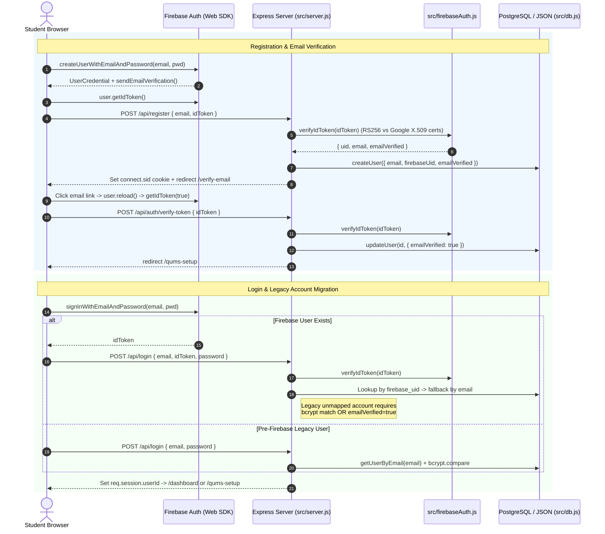

# QAttend — Authentication & Authorization Architecture

This document explains how **QAttend** authenticates users, manages sessions, integrates Firebase Authentication, and enforces role-based permissions.

---

## 1. High-Level Architecture: Two Distinct Auth Boundaries

QAttend separates **Application Authentication** (accessing QAttend itself) from **University ERP Authentication** (accessing Quantum University's portals):

| Boundary | Authority | Storage | Purpose |
| :--- | :--- | :--- | :--- |
| **Application Account Auth** | **Firebase Authentication** (Email/Password) + legacy `bcryptjs` fallback | **Firebase Auth** (passwords, verification state, UID) + **PostgreSQL `users`** (`id`, `email`, `firebase_uid`, `email_verified`, `is_admin`, `is_suspended`) + **Express FileStore** (`data/app-sessions/`) | Identifies the QAttend user and maintains their HTTP session (`req.session.userId`). |
| **University ERP Auth** | **Quantum University Portals** (Old ERP & New ERP) | **Playwright `storageState` JSON** (disk + AES-256-GCM encrypted in `users`) + **AES-256-GCM encrypted ERP passwords** (`users.qums_password_encrypted`, `users.new_erp_password_encrypted`) | Allows QAttend scrapers/watchers to query university attendance, timetable, and assignments. **Firebase never stores university ERP credentials.** |

---

## 2. Firebase Authentication Integration

### 2.1 Firebase Project Configuration
- **Client Config (`public/firebase-config.js`):** Exports `firebaseConfig` for Firebase project `qums-forgot-password-test` (`authDomain`, `projectId`, `storageBucket`, `messagingSenderId`, `appId`, `measurementId`, and public Web `apiKey`).
- **Frontend SDK Loading:** `public/login.html`, `public/register.html`, `public/forgot.html`, and `public/verify-email.html` dynamically import Firebase JS SDK `10.12.2` (`firebase-app.js` and `firebase-auth.js`) from `https://www.gstatic.com/firebasejs/10.12.2/`.
- **Server-Side Project Binding (`src/firebaseAuth.js`):** Uses `process.env.FIREBASE_PROJECT_ID || 'qums-forgot-password-test'` for JWT `aud` and `iss` validation.

### 2.2 Email Registration & Verification
1. **Frontend (`public/register.html`):**
   - Validates email format, password length (`>= 6`), and password confirmation.
   - Calls `createUserWithEmailAndPassword(auth, email, password)`.
   - Calls `sendEmailVerification(credential.user)` to trigger Firebase's verification email.
   - Obtains `idToken = await credential.user.getIdToken()` and submits `POST /api/register` with `{ email, idToken }`.
   - *Offline/CDN Fallback:* If loading the Firebase ESM CDN fails (non-`auth/` error), the browser submits `{ email, password, firebaseUnavailable: true }`.
2. **Backend (`src/server.js` — `POST /api/register`):**
   - Rate-limited (`10` requests / 15 min per IP).
   - Rejects duplicate emails (`409`) via `db.getUserByEmail(normalizedEmail)`.
   - With `idToken`: calls `establishSessionFromIdToken()` → `firebaseAuth.verifyIdToken(idToken)` → `resolveAppUserForFirebase()` → creates `users` row with random 24-byte placeholder `password_hash`, `firebase_uid`, and `email_verified: Boolean(verified.emailVerified)`. Sets `req.session.userId`.
   - With `firebaseUnavailable === true`: hashes password with `bcrypt.hash(password, 10)` and creates user with `emailVerified: false` (note: because no Firebase user was created, that user cannot complete `/verify-email` via Firebase unless registered/reset into Firebase).
3. **Verification Enforcement (`public/verify-email.html` & `src/server.js`):**
   - `requireAuth` and `requireAdmin` block access when `!user.emailVerified`: API routes return `403 { code: 'EMAIL_VERIFICATION_REQUIRED' }`; page routes redirect to `/verify-email`.
   - On `/verify-email`, the client listens to `onAuthStateChanged`, lets users click **"I've Verified — Check Again"** (`user.reload()` → `user.getIdToken(true)` → `POST /api/auth/verify-token`), or **"Resend Verification Email"** (60s `localStorage` cooldown).
   - `POST /api/auth/verify-token` verifies the refreshed JWT, confirms `verified.emailVerified === true`, updates `users.email_verified = TRUE`, sets `req.session.userId`, and returns `redirect` (`/dashboard` if `qumsSessionPath` exists, else `/qums-setup`). *(Note: check in `/api/auth/verify-token` redirects based on `qumsSessionPath` even for New ERP users.)*

### 2.3 Google Sign-In
- **Status: Missing / Not Implemented.**
- Neither `public/login.html` nor `public/register.html` imports or invokes `GoogleAuthProvider`, `signInWithPopup`, or `signInWithRedirect`. Only Email/Password authentication is implemented.

### 2.4 Login & Legacy User Migration
1. **Frontend (`public/login.html`):**
   - Pre-warms Firebase SDK on page load.
   - Calls `signInWithEmailAndPassword(auth, email, password)` → gets `idToken`.
   - If Firebase throws `auth/user-disabled` or `auth/too-many-requests`, stops and shows error. For other `auth/*` errors (e.g., `auth/user-not-found` for pre-Firebase legacy users, or `auth/wrong-password`), it still forwards `{ email, password }` (without `idToken`) to `POST /api/login` so the backend bcrypt fallback can run.
2. **Backend (`src/server.js` — `POST /api/login`):**
   - Rate-limited (`20` requests / 15 min per IP).
   - **If `idToken` is provided:** `establishSessionFromIdToken()` verifies the JWT and runs `resolveAppUserForFirebase(verified, password)`:
     1. Lookup by `firebase_uid` (`db.getUserByFirebaseUid(uid)`): syncs `email` or `emailVerified` if changed.
     2. Lookup by `email` (`db.getUserByEmail(email)`): if `firebaseUid` is empty (pre-Firebase legacy account), enforces **Anti-Takeover Gate**: requires either valid `bcrypt.compare(password, byEmail.passwordHash)` **OR** `verified.emailVerified === true`. Otherwise returns `403 { code: 'MIGRATE_PASSWORD' }`.
     3. If neither exists in Postgres (e.g., created directly in Firebase), creates a new `users` row automatically.
   - **If no `idToken`:** Runs legacy `bcrypt.compare(password, user.passwordHash)` against `users.password_hash`.

### 2.5 Password Reset
1. **Frontend (`public/forgot.html`) + Backend (`POST /api/forgot`):**
   - User submits email to `POST /api/forgot` (rate-limited `5` / 15 min per IP).
   - Backend checks `db.getUserByEmail(normalizedEmail)`. If unregistered, returns `404 { registered: false }` so no reset email is triggered and no Firebase account is probed directly first.
   - If registered, frontend calls Firebase `sendPasswordResetEmail(auth, email)`.
2. **Reset Landing (`GET /reset` & `POST /api/reset`):**
   - **Important Implementation Detail:** Although `FIREBASE_SETUP.md` describes a `/reset?oobCode=...` page using `confirmPasswordReset`, `src/server.js` line 301 defines `app.get('/reset', (req, res) => res.redirect('/login'))` and there is **no `public/reset.html`**. Firebase's default hosted action handler handles the reset link, or users land on `/login`.
   - `POST /api/reset` remains strictly as a legacy fallback for old SHA-256 tokens stored in the `resets` table (`db.consumeResetToken`). No new tokens are inserted into `resets`.

---

## 3. Firebase ID Token Verification & Firebase Admin SDK (`src/firebaseAuth.js`)

### 3.1 Token Verification (Zero-Secret Public Key)
`verifyIdToken(idToken, deps)` implements full RS256 JWT validation using Node's built-in `crypto` module without requiring Firebase Admin credentials:
1. Splits the 3-part JWT and decodes header/payload (`base64url`).
2. Enforces `header.alg === 'RS256'` and presence of `header.kid`.
3. Fetches Google's public X.509 certificates from `https://www.googleapis.com/robot/v1/metadata/x509/securetoken@system.gserviceaccount.com`, caching them in `certCache` respecting `Cache-Control: max-age` clamped to `[300s, 3600s]`.
4. Verifies signature via `crypto.verify('sha256', data, new crypto.X509Certificate(certPem).publicKey, sig)`.
5. Validates claims (`CLOCK_SKEW_SECONDS = 300`):
   - `payload.aud === FIREBASE_PROJECT_ID`
   - `payload.iss === https://securetoken.google.com/${FIREBASE_PROJECT_ID}`
   - `nowSec < payload.exp + 300`
   - `payload.iat <= nowSec + 300`
   - Non-empty `payload.sub` (Firebase UID) and `payload.email`.
6. Returns `{ uid, email: normalizeEmail(payload.email), emailVerified: Boolean(payload.email_verified) }`.

### 3.2 Firebase Admin SDK (`deleteFirebaseUser`)
Despite `FIREBASE_SETUP.md` stating no Admin SDK is used, `src/firebaseAuth.js` (lines 215–436) integrates `firebase-admin` specifically for Admin user deletion (`deleteFirebaseUser`):
- Credential lookup order in `getFirebaseAdminApp()`:
  1. Cached credentials loaded from Supabase `system_settings` (`key = 'firebase_service_account_key'`), configured via Admin UI (`POST /api/admin/firebase-credentials`).
  2. Environment variables (`FIREBASE_SERVICE_ACCOUNT`, `FIREBASE_SERVICE_ACCOUNT_KEY`, `FIREBASE_ADMIN_CREDENTIALS` — raw JSON, base64-encoded JSON, or file path).
  3. Local JSON files (`GOOGLE_APPLICATION_CREDENTIALS`, `serviceAccountKey.json`, `firebase-service-account.json`, `service-account.json`).
  4. `FIREBASE_CLIENT_EMAIL` + `FIREBASE_PRIVATE_KEY`.
- `deleteFirebaseUser({ uid, email })` deletes the user from Firebase Auth (`deleteUser` / `getUserByEmail`) and best-effort cleans `users/{uid}` in Firestore and Realtime Database if present.

---

## 4. Backend Session Management & Middleware (`src/server.js`)

### 4.1 Express Session Configuration
- Store: `session-file-store` writing JSON session files to `data/app-sessions/`.
- TTL: `90 * 24 * 60 * 60` seconds (90 days).
- Cookie settings:
  - `httpOnly: true`
  - `sameSite: 'lax'`
  - `secure: IS_PROD` (`NODE_ENV === 'production'` or `Boolean(process.env.RENDER)`)
  - `maxAge: 90 * 24 * 60 * 60 * 1000`
- Proxy trust: `app.set('trust proxy', 1)` for Render TLS termination.
- Session state payload: Stores only `req.session.userId` (16-hex-char internal ID from `users.id`).

### 4.2 Middleware Flow (`requireAuth` & `requireAdmin`)
1. **`currentUser(req)`:** Reads `req.session.userId` and fetches the row from `db.getUserById(req.session.userId)`.
2. **`requireAuth(req, res, next)`:**
   - No user → `401 AUTH_REQUIRED` (API) or `302 /login` (page).
   - `user.isSuspended` → clears `req.session.userId = null`, returns `403 ACCOUNT_SUSPENDED` (API) or 403 HTML notice (page).
   - `!user.emailVerified` → returns `403 EMAIL_VERIFICATION_REQUIRED` (API) or `302 /verify-email` (page).
   - Passes → sets `req.appUser = user` and calls `next()`.
3. **`requireAdmin(req, res, next)`:**
   - Performs all `requireAuth` checks above, then evaluates `isUserAdmin(user)`:
     ```js
     user.isAdmin === true || ADMIN_EMAILS.includes(user.email.toLowerCase())
     ```
   - Non-admin → `403 ADMIN_REQUIRED` (API) or `403 Forbidden` HTML (page).

### 4.3 Logout & Account Recovery
- **Logout (`GET /logout`):** Calls `req.session.destroy(() => res.redirect('/login'))`. Note that standard `/logout` links on `/dashboard`, `/qums-setup`, `/telegram-setup`, and `/admin` do **not** call `firebase.auth().signOut()`; only `verify-email.html`'s Logout button calls `fb.signOut(fb.auth)` before `/logout`.
- **Account Recovery:** Handled via Firebase password reset (`/forgot`). There is no self-service account deletion endpoint for students; students must submit a request via `/contact` or be deleted by an Admin.

---

## 5. Role-Based Permissions Matrix

QAttend implements a **two-role model** (`Student` vs `Admin`), with no intermediate roles (such as Faculty, HOD, or Moderator):

| Role | Assignment Mechanism | Accessible Pages | Accessible APIs / Bot Commands |
| :--- | :--- | :--- | :--- |
| **Anonymous** | Unauthenticated | `/`, `/features`, `/how-it-works`, `/about`, `/faq`, `/contact`, `/privacy`, `/terms`, `/guides/*`, `/login`, `/register`, `/forgot` | `/api/register`, `/api/login`, `/api/forgot`, `/api/reset`, `/api/contact`, `/api/auth/verification-status`, `/api/auth/verify-token`, `/health` |
| **Unverified Student** | `req.session.userId` set, `emailVerified === false` | `/verify-email` | `/api/auth/verify-token`, `/api/auth/verification-status` |
| **Verified Student** | `emailVerified === true`, `isSuspended === false` | `/dashboard`, `/qums-setup`, `/telegram-setup` | `/api/me`, `/api/attendance`, `/api/today`, `/api/timetable`, `/api/trigger-telegram`, `/api/qums-login/*`, `/api/qums-reset`, `/api/qums-logout`, `/api/new-erp/*`, `/api/erp/switch`, `/api/telegram/*`; Bot user commands |
| **Suspended User** | `isSuspended === true` | Blocked (session cleared) | Blocked at `/api/login`, `requireAuth`, `requireAdmin`, and skipped by `watcher.js` / `scheduler.js` / Telegram admin broadcasts |
| **Admin** | `users.is_admin = TRUE` OR email in `process.env.ADMIN_EMAILS` | All Student pages + `/admin` | All Student APIs + `/api/admin/*` + Telegram `/admin` interactive panel (`src/telegram-admin.js` checks `isChatAdmin(chatId)`) |

---

## 6. Authentication Sequence Diagram



