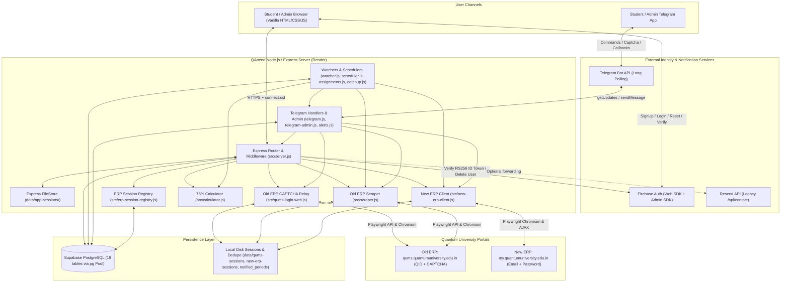

# QAttend — Complete Technical Architecture & GUeAttend Adaptation Blueprint

This master document synthesizes QAttend's end-to-end architecture, complete inventories, security findings, and the exact adaptation blueprint required to build **GUeAttend** independently for **Graphic Era University (GUeID)**.

---

## 1. End-to-End System Architecture

---

## 2. Complete Inventories Summary

### 2.1 Complete Feature Inventory
- **Implemented:** Public landing + 11 SEO/guide/legal pages; Firebase Email/Password auth + email verification + legacy bcrypt fallback; Old ERP QID+CAPTCHA Playwright relay; New ERP Email+Password login + active session conflict logout; ERP mutual exclusivity (`OLD` vs `NEW`); Student Dashboard (Overall %, Subject-wise %, 75% calculator, Today's classes, Weekly timetable, New ERP Subject Lecture Modal); Background Watchers (Fast College-Hours Today loop, 24/7 Tiered Month-Register backdated loop, 08:15 prewarm + 08:30 AM IST morning timetable + boot catch-up); Silent baseline & Reconnect catch-up; Telegram Bot (deep-link binding, `/attendance`, `/today`, `/assignments`, `/status`, `/reconnect`, `/DD/MM/YY`, `/help`, `/admin`, persistent auto-delete); Web Admin Portal (health, multi-filter search, `.xlsx` export, suspend, dual Supabase+Firebase delete, bulk reconnect notify, runtime Firebase key config).
- **Partially Implemented:**
  - *Assignments:* Backend scraper + watcher + 7 PM reminder (`src/assignments.js`) + `/api/new-erp/assessments` exist, but notifications require `ENABLE_ASSIGNMENTS=true` and there is **no Web Dashboard UI** for assignments.
  - *Date-Range & Month Register Web UI:* JS logic exists in `public/index.html` for `#toggleDatePickerBtn` & `#sliderCardsWrapper`, but the HTML elements were removed/absent; date lookup works on Telegram only.
  - *Telegram `/admin` Panel:* Bulk actions & user viewing work, but single-user buttons `adm:user_delete_prompt`, `adm:user_msg`, `adm:user_release_session` have no callback handlers.
  - *Google AdSense:* `ads.txt`, `robots.txt`, and `home.html` Auto-Ads script exist; `.ad-slot` divs across 14 pages are empty placeholders.
  - *Profile & Settings:* View-only ERP profile cache + `/qums-setup` + `/telegram-setup` (no profile edit or dedicated `/settings` page).
- **Missing (Not Implemented):** Google Sign-In; custom `/reset` page (`GET /reset` redirects to `/login`); Academic Sessions CRUD; Class Substitutions; Upcoming Classes countdown; Examinations; Results; Fees; Circulars; Grievances; Fine-grained RBAC beyond Student/Admin.

### 2.2 Complete Database Inventory (19 Tables)
`schema_migrations`, `users`, `resets`, `qums_identities`, `active_erp_sessions`, `known_attendance`, `attendance_records`, `weekly_schedule`, `new_erp_timetable`, `new_erp_attendance_cache`, `known_assignments`, `assignments`, `session_expiry_state`, `notifications`, `notification_log`, `scheduled_message_deletions`, `reconnect_events`, `admin_audit_logs`, `system_settings`. *(Zero RLS policies; accessed via privileged `DATABASE_URL` pool.)*

### 2.3 Complete API Inventory (34 Routes)
- **Public/Auth:** `POST /api/register`, `POST /api/login`, `POST /api/auth/verify-token`, `GET /api/auth/verification-status`, `POST /api/forgot`, `POST /api/reset`, `POST /api/contact`, `GET /health`.
- **Student & Old ERP (`requireAuth`):** `GET /api/me`, `GET /api/attendance`, `GET /api/today`, `GET /api/timetable`, `ALL /api/trigger-telegram`, `POST /api/qums-login/start`, `POST /api/qums-login/submit-captcha`, `POST /api/qums-reset`, `POST /api/qums-logout`.
- **New ERP & Switch (`requireAuth`):** `POST /api/new-erp/login`, `POST /api/new-erp/disconnect`, `POST /api/erp/switch`, `GET /api/new-erp/timetable`, `GET /api/new-erp/attendance`, `GET /api/new-erp/subject-attendance`, `GET /api/new-erp/assessments`, `POST /api/new-erp/reconnect`.
- **Telegram (`requireAuth`):** `GET /api/telegram/status`, `POST /api/telegram/unlink`.
- **Admin (`requireAdmin`):** `GET /api/admin/users`, `GET /api/admin/users/all-ids`, `GET /api/admin/export/excel`, `GET /api/admin/health`, `POST /api/admin/users/:id/suspend`, `POST /api/admin/users/:id/delete`, `DELETE /api/admin/users/:id`, `POST /api/admin/firebase-credentials`, `POST /api/admin/firebase-users/delete`, `POST /api/admin/users/bulk-reconnect-notify`.

---

## 3. GUeAttend Adaptation Blueprint (Graphic Era University — GUeID)

To build **GUeAttend** as a completely independent platform for **Graphic Era University (GUeID)**, adapt every component below:

### 3.1 University Portal & Identification Replacement
1. **Identity System (`QID` → `GUeID`):**
   - Rename schema columns (`qums_qid` → `gue_id`, `qums_identities` → `erp_identities` / `gue_identities`, `qums_year_sem` → `erp_year_sem`, etc.) and UI labels/placeholders (`QUMS QID` → `Graphic Era University ID (GUeID)`).
   - Remove Quantum University hardcoded fallbacks in `src/server.js`, `src/telegram.js`, and `public/qums-setup.html`.
2. **University ERP Client & Scraper (`src/login.js`, `src/qums-login-web.js`, `src/scraper.js`, `src/new-erp-client.js`):**
   - Replace `qums.quantumuniversity.edu.in` and `my.quantumuniversity.edu.in` URLs and Cyborg ASP.NET endpoints (`GetYearSemWiseAttendance`, `GetTodayAttendance`, `GetMonthRegister`, `FillStudentTimeTable`, `GetStudentAssignment`, `GetWeekCalendarStudentData`) with **Graphic Era University's actual ERP endpoints and DOM/JSON parsers** (must be reverse-engineered against authorized Graphic Era student portal sessions).
   - Adapt CAPTCHA / OTP / 2FA / anti-forgery token handling to match Graphic Era's login flow.
   - If Graphic Era uses a single ERP instead of two, simplify `active_erp_sessions` and remove Old/New ERP dual-tab UI (`qums-setup.html`, `index.html`).

### 3.2 Independent Cloud Infrastructure & Secrets
1. **New Firebase Project:** Create a dedicated Firebase project for GUeAttend; replace `public/firebase-config.js` and `FIREBASE_PROJECT_ID`; configure Authorized Domains and Email templates for GUeAttend.
2. **New Supabase PostgreSQL Database:** Provision a separate Supabase project and fresh `DATABASE_URL`.
3. **New Telegram Bot:** Create a new bot via `@BotFather` (e.g., `@gueattend_bot`) with its own `TELEGRAM_BOT_TOKEN` and `TELEGRAM_BOT_USERNAME`.
4. **New Cryptographic Keys:** Generate new `SESSION_SECRET` and `ENCRYPTION_KEY`; change `src/crypto.js` to use per-secret random salts instead of a static salt string.
5. **New Hosting & Domain:** Deploy to a separate Render service with its own `APP_BASE_URL` (e.g., `https://gueattend.onrender.com`).

### 3.3 Branding, SEO & Legal Assets
- Update all brand strings (`QAttend` → `GUeAttend`, `QUMS` → Graphic Era ERP) across `public/*.html`, `src/messages.js`, `src/alerts.js`, `src/telegram.js`, `src/telegram-admin.js`, and Excel export filenames (`qattend-users-*.xlsx` → `gueattend-users-*.xlsx`).
- Update `public/robots.txt`, `public/sitemap.xml`, canonical URLs, JSON-LD, `google-site-verification`, `ads.txt`, and `CONTACT_EMAIL`.
- Update `public/privacy.html` and `public/terms.html` to accurately state Graphic Era University non-affiliation and exact credential retention behavior (if ERP passwords are stored encrypted for reconnect, disclose it accurately).

### 3.4 Recommended Architectural & Security Upgrades for GUeAttend
1. **Eliminate XSS `innerHTML` Patterns:** Replace all `innerHTML` interpolations in `index.html`, `admin.html`, and setup pages with `textContent` / DOM element builders.
2. **Store Express Sessions in PostgreSQL (`connect-pg-simple`):** Replace `session-file-store` so Render restarts/redeploys do not log out students.
3. **Add Security Middleware:** Add `helmet` (CSP, HSTS, `X-Frame-Options`), CSRF token validation on POST/DELETE routes, convert `GET /logout` to `POST /logout`, and enforce `POST`-only on `/api/trigger-telegram`.
4. **Tighten TLS & Secrets:** Remove `ignoreHTTPSErrors: true` where possible, encrypt `system_settings` secrets via `encryptSecret()`, and fail fast on boot in production if `SESSION_SECRET` or `ENCRYPTION_KEY` is missing.
5. **Rate Limit Playwright Routes:** Add per-user + per-IP rate limiting on CAPTCHA/login endpoints to prevent Chromium memory exhaustion.
6. **Complete Incomplete Features:** Wire `ENABLE_ASSIGNMENTS` UI tab on the student dashboard, fix `schedulerStatus` updates, implement missing `telegram-admin.js` single-user callbacks, log web admin actions into `admin_audit_logs`, and add Google Sign-In (`GoogleAuthProvider`) + custom `/reset` page if desired.
7. **Database RLS (Optional):** If GUeAttend ever uses `@supabase/supabase-js` from clients or edge functions, add `ALTER TABLE ... ENABLE ROW LEVEL SECURITY` and strict `auth.uid()` / `user_id` policies on every table.

