# QAttend — Supabase PostgreSQL Database Schema Audit

This document audits the complete database schema implemented in `src/migrations.js` and queried in `src/db.js`.

---

## 1. Database Architecture & Execution Model

- **Engine:** Supabase PostgreSQL accessed via `pg` (`Pool`, `max: PG_POOL_MAX || 5`) using `process.env.DATABASE_URL`.
- **TLS:** `sslConfig()` in `src/db.js` enables `{ rejectUnauthorized: false }` for remote hosts (`supabase.*`, `render.com`, `amazonaws.com`, `neon.tech`, `sslmode=require`, or `NODE_ENV=production`) unless overridden by `DATABASE_SSL=disable|verify`.
- **Local Fallback:** When `DATABASE_URL` is unset, `src/db.js` uses an in-memory store persisted atomically (`temp + rename`) to `data/db.json` (or `process.env.DB_FILE`).
- **Migration Runner (`runMigrations` in `src/db.js`):**
  - Runs automatically on `db.init()` at server boot.
  - Executes each SQL statement in `MIGRATIONS` (`001`–`022`) **individually** (`pool.query(stmt)`) so one failed statement never aborts subsequent migrations.
  - Records completed migration IDs in `schema_migrations`.
  - Opt-in migration `900_drop_qums_password_column` runs only if `DROP_QUMS_PASSWORD_COLUMN=1`.
- **Row-Level Security (RLS):** **NONE.** No `ENABLE ROW LEVEL SECURITY` or `CREATE POLICY` statements exist anywhere in the codebase. QAttend does not use `@supabase/supabase-js`; all database access runs server-side through the privileged `DATABASE_URL` connection pool, relying on Express route logic (`user_id = $1`) for multi-tenant isolation.

---

## 2. Complete Table Inventory (19 Tables)

### 2.1 `schema_migrations`
- **Purpose:** Tracks applied idempotent migration IDs.
- **Columns:** `id` (`TEXT` PK), `applied_at` (`TIMESTAMPTZ NOT NULL DEFAULT NOW()`).
- **Used by:** `src/db.js:runMigrations`.

### 2.2 `users`
- **Purpose:** Central multi-tenant application user record holding auth identity, cached ERP profile metadata, encrypted ERP passwords/sessions, Telegram linking state, monitoring boundary dates, and reconnect telemetry.
- **Primary Key:** `id` (`TEXT`, 16-char hex from `crypto.randomBytes(8).toString('hex')`).
- **Unique Constraints:** `email` (`TEXT UNIQUE NOT NULL`).
- **Columns:**

| Column | Type | Default / Constraint | Purpose / Notes |
| :--- | :--- | :--- | :--- |
| `id` | `TEXT` | `PRIMARY KEY` | Internal user ID (`req.session.userId`) |
| `email` | `TEXT` | `UNIQUE NOT NULL` | Normalized lowercase login email |
| `password_hash` | `TEXT` | `NOT NULL` | `bcryptjs` hash (legacy fallback or random 24B placeholder for Firebase users) |
| `firebase_uid` | `TEXT` | `''` | Linked Firebase Auth UID (Mig `002`) |
| `is_admin` | `BOOLEAN` | `NOT NULL DEFAULT FALSE` | Admin flag (Mig `005`) |
| `email_verified` | `BOOLEAN` | `NOT NULL DEFAULT FALSE` | Verified via Firebase ID token (Mig `014`) |
| `is_suspended` | `BOOLEAN` | `NOT NULL DEFAULT FALSE` | Admin account suspension flag (Mig `015`) |
| `qums_qid` | `TEXT` | `''` | Quantum University QID (Old ERP) |
| `qums_password_encrypted` | `TEXT` | `''` | AES-256-GCM encrypted Old ERP password (Mig `013`, opt-in drop in `900`) |
| `qums_session_path` | `TEXT` | `''` | Disk path `data/qums-sessions/<id>.json` |
| `qums_session_data` | `TEXT` | `''` | AES-256-GCM encrypted Playwright `storageState` JSON (Mig `017`) |
| `qums_session_status` | `TEXT` | `'active'` | `'active'` \| `'expired'` \| `'disconnected'` (Mig `011`) |
| `student_name` | `TEXT` | `''` | Cached Old ERP student name (Mig `003`) |
| `qums_year_sem` | `TEXT` | `''` | Cached Old ERP Year/Sem `1..8` (Mig `004`) |
| `active_erp_type` | `TEXT` | `'OLD'` | `'OLD'` \| `'NEW'` (Mig `021`) |
| `new_erp_email` | `TEXT` | `''` | Registered email for New ERP (Mig `021`) |
| `new_erp_password_encrypted` | `TEXT` | `''` | AES-256-GCM encrypted New ERP password (Mig `021`) |
| `new_erp_session_path` | `TEXT` | `''` | Disk path `data/new-erp-sessions/<id>.json` (Mig `021`) |
| `new_erp_session_data` | `TEXT` | `''` | AES-256-GCM encrypted New ERP `storageState` JSON (Mig `021`) |
| `new_erp_session_status` | `TEXT` | `'not_setup'` | `'not_setup'` \| `'active'` \| `'expired'` \| `'disconnected'` (Mig `021`) |
| `new_erp_student_name` | `TEXT` | `''` | Cached New ERP student name (Mig `021`) |
| `new_erp_qid` | `TEXT` | `''` | Cached New ERP Student ID/QID (Mig `021`) |
| `new_erp_academic_year` | `TEXT` | `''` | Cached New ERP academic year e.g. `2026 - 2029` (Mig `021`) |
| `new_erp_semester` | `TEXT` | `''` | Cached New ERP semester (Mig `021`) |
| `new_erp_course` | `TEXT` | `''` | Cached New ERP degree/course name (Mig `021`) |
| `new_erp_last_synced_at` | `TIMESTAMPTZ` | `NULL` | Last New ERP sync timestamp (Mig `021`) |
| `telegram_link_code` | `TEXT` | `''` | 12-char hex deep-link payload (`/start <code>`) |
| `telegram_chat_id` | `TEXT` | `''` | Linked Telegram chat ID (1 chat per user) |
| `monitoring_started_at` | `TIMESTAMPTZ` | `NULL` | First QUMS setup timestamp (Mig `011`) |
| `monitoring_started_date` | `DATE` | `NULL` | IST civil date boundary; older classes never notify (Mig `012`) |
| `attendance_last_checked_at` | `TIMESTAMPTZ` | `NULL` | Last attendance watcher check (Mig `006`) |
| `assignment_last_checked_at` | `TIMESTAMPTZ` | `NULL` | Last assignment check (Mig `006`) |
| `last_attendance_sync_at` | `TIMESTAMPTZ` | `NULL` | Updated alongside `attendance_last_checked_at` (Mig `011`) |
| `last_assignment_sync_at` | `TIMESTAMPTZ` | `NULL` | Updated alongside `assignment_last_checked_at` (Mig `011`) |
| `profile_synced_at` | `TIMESTAMPTZ` | `NULL` | Last `fetchQumsProfile` sync (Mig `006`) |
| `last_error` | `TEXT` | `''` | Last sync error label (Mig `006`) |
| `last_reconnect_source` | `TEXT` | `''` | `'telegram'` \| `'web'` (Mig `020`) |
| `last_reconnected_at` | `TIMESTAMPTZ` | `NULL` | Last reconnect timestamp (Mig `020`) |
| `reconnect_count_telegram` | `INTEGER` | `0` | Telegram reconnect counter (Mig `020`) |
| `reconnect_count_web` | `INTEGER` | `0` | Webpage reconnect counter (Mig `020`) |
| `created_at` | `TIMESTAMPTZ` | `NOT NULL DEFAULT NOW()` | Account creation time |
| `updated_at` | `TIMESTAMPTZ` | `NOT NULL DEFAULT NOW()` | Last update time (Mig `011`) |

- **Indexes:** `idx_users_firebase_uid`, `idx_users_is_admin`, `idx_users_email`, `idx_users_telegram_chat`, `idx_users_telegram_link_code`, `idx_users_created_at`, `idx_users_monitoring_started_date`, `idx_users_email_verified`, `idx_users_is_suspended`.
- **Important Queries:** `getUserByEmail`, `getUserById`, `getUserByFirebaseUid`, `createUser`, `updateUser` (via `WRITABLE_USER_COLUMNS` whitelist), `touchUserSync`, `deleteUser`, `listUsersForAdmin`, `adminStats`, `recordUserReconnect`.

### 2.3 `resets`
- **Purpose:** Legacy password-reset tokens (1h TTL). Retained only for backward-compatible `POST /api/reset`; no new tokens are generated.
- **Columns:** `email` (`TEXT` PK), `token_hash` (`TEXT NOT NULL`), `expires_at` (`BIGINT NOT NULL`).
- **Queries:** `storeResetToken`, `consumeResetToken`.

### 2.4 `qums_identities`
- **Purpose:** Tracks multiple QIDs linked to one user over time when switching QIDs, preserving per-QID `monitoring_started_date`.
- **Columns:** `id` (`TEXT` PK), `user_id` (`TEXT NOT NULL` FK → `users.id ON DELETE CASCADE`), `qid` (`TEXT NOT NULL`), `student_name` (`TEXT DEFAULT ''`), `year_sem` (`TEXT DEFAULT ''`), `monitoring_started_at` (`TIMESTAMPTZ DEFAULT NOW()`), `monitoring_started_date` (`DATE`), `is_active` (`BOOLEAN NOT NULL DEFAULT TRUE`), `created_at`, `updated_at`.
- **Unique:** `(user_id, qid)`. **Indexes:** `idx_qums_identities_user`, `idx_qums_identities_qid`.
- **Used by:** `qums-login-web.js:completeQumsSetup`, `POST /api/qums-reset` (`switchQumsIdentity`, `getActiveQumsIdentity`).

### 2.5 `active_erp_sessions`
- **Purpose:** Centralized session exclusivity registry enforcing "One QUMS account = One active ERP (`OLD` or `NEW`)".
- **Columns:** `qums_identity` (`TEXT` PK, normalized lowercase QID or New ERP email), `user_id` (`TEXT NOT NULL` FK → `users.id ON DELETE CASCADE`), `erp_type` (`TEXT NOT NULL`, `'OLD'`|`'NEW'`), `session_id` (`TEXT NOT NULL`), `status` (`TEXT NOT NULL DEFAULT 'active'`, `'active'`|`'released'`), `created_at`, `updated_at`, `last_active_at`.
- **Index:** `idx_active_erp_user(user_id)`.
- **Used by:** `src/erp-session-registry.js` during Old/New ERP login, `/api/erp/switch`, `/api/qums-logout`, `/api/new-erp/disconnect`, admin suspend/delete.

### 2.6 `known_attendance`
- **Purpose:** JSONB snapshot per user of known month-register attendance records used by `watcher.js` and `catchup.js` to diff new or status-changed marks (capped at 5,000 records per user).
- **Columns:** `user_id` (`TEXT` PK, FK → `users.id ON DELETE CASCADE`), `records` (`JSONB NOT NULL DEFAULT '[]'::jsonb`).
- **Used by:** `watcher.js:runMonthRegisterCycle`, `catchup.js`, Telegram `/attendance` and `/DD/MM/YY` offline cache fallback.

### 2.7 `attendance_records`
- **Purpose:** Normalized relational mirror of `known_attendance` per `(user_id, qid, subject_code, class_date)`.
- **Columns:** `id` (`BIGSERIAL` PK), `user_id` (`TEXT NOT NULL` FK → `users.id ON DELETE CASCADE`), `qid` (`TEXT NOT NULL`), `subject_code` (`TEXT NOT NULL`), `subject_name` (`TEXT DEFAULT ''`), `class_date` (`TEXT NOT NULL`), `status` (`TEXT NOT NULL`), `first_seen_at`, `last_seen_at`, `created_at`, `updated_at`.
- **Unique:** `(user_id, qid, subject_code, class_date)`.
- **Indexes:** `idx_att_records_user_date`, `idx_att_records_user_subj_date`.
- **Used by:** `upsertKnownAttendance` mirror, `catchup.js:runReconnectCatchup`.

### 2.8 `weekly_schedule`
- **Purpose:** 7-day TTL cache of Old ERP daily timetable slots (`day_of_week` 0–6) for fast 08:30 AM IST morning messages and Telegram `/today` fallback.
- **Columns:** `user_id` (`TEXT NOT NULL` FK → `users.id ON DELETE CASCADE`), `day_of_week` (`INTEGER NOT NULL`), `period` (`TEXT NOT NULL`), `duration` (`TEXT DEFAULT ''`), `subject` (`TEXT DEFAULT ''`), `subject_code` (`TEXT DEFAULT ''`), `teacher` (`TEXT DEFAULT ''`), `room` (`TEXT DEFAULT ''`), `last_updated` (`TIMESTAMPTZ NOT NULL DEFAULT NOW()`).
- **PK:** `(user_id, day_of_week, period)`. **Index:** `idx_weekly_user_day`.
- **Used by:** `scraper.js:getTodaysScheduleWithRoom`, `scheduler.js:getMorningScheduleText`, `telegram.js:handleToday`.

### 2.9 `new_erp_timetable`
- **Purpose:** Persistent cache of New ERP weekly timetable rows.
- **Columns:** `user_id` (`TEXT NOT NULL` FK → `users.id ON DELETE CASCADE`), `day_of_week` (`INTEGER NOT NULL`), `period_time` (`TEXT NOT NULL`), `subject_name` (`TEXT NOT NULL`), `faculty_name` (`TEXT DEFAULT ''`), `classroom` (`TEXT DEFAULT ''`), `raw_data` (`JSONB NOT NULL DEFAULT '{}'::jsonb`), `last_updated` (`TIMESTAMPTZ NOT NULL DEFAULT NOW()`).
- **PK:** `(user_id, day_of_week, period_time, subject_name)`. **Index:** `idx_new_erp_tt_user`.
- **Used by:** `/api/today`, `/api/new-erp/timetable`, `scheduler.js`, `telegram.js`.

### 2.10 `new_erp_attendance_cache`
- **Purpose:** Persistent cache of New ERP overall summary, subject-wise list, and daily lecture records.
- **Columns:** `user_id` (`TEXT` PK, FK → `users.id ON DELETE CASCADE`), `summary` (`JSONB NOT NULL DEFAULT '{}'::jsonb`), `subject_wise` (`JSONB NOT NULL DEFAULT '[]'::jsonb`), `daily_records` (`JSONB NOT NULL DEFAULT '[]'::jsonb`), `last_updated` (`TIMESTAMPTZ NOT NULL DEFAULT NOW()`).
- **Used by:** `/api/new-erp/attendance`, `telegram.js:handleAttendance`, `handleToday`, `handleDateAttendance`.

### 2.11 `known_assignments`
- **Purpose:** JSONB snapshot per user for assignment notification & deadline reminder deduplication, plus `telegramMessageId` tracking for auto-deletion when uploaded (`uploadFlag === 1`), capped at 2,000 entries.
- **Columns:** `user_id` (`TEXT` PK, FK → `users.id ON DELETE CASCADE`), `records` (`JSONB NOT NULL DEFAULT '[]'::jsonb`).
- **Used by:** `src/assignments.js`, `src/catchup.js`, `telegram.js:handleAssignments`.

### 2.12 `assignments`
- **Purpose:** Relational mirror of discovered assignments per user.
- **Columns:** `id` (`BIGSERIAL` PK), `user_id` (`TEXT NOT NULL` FK → `users.id ON DELETE CASCADE`), `qid` (`TEXT DEFAULT ''`), `external_assignment_id` (`TEXT NOT NULL`), `subject` (`TEXT DEFAULT ''`), `title` (`TEXT DEFAULT ''`), `last_date` (`TEXT DEFAULT ''`), `first_seen_at`, `last_seen_at`, `created_at`, `updated_at`.
- **Unique:** `(user_id, external_assignment_id)`. **Index:** `idx_assignments_user_qid`.
- **Used by:** `addKnownAssignments` mirror, `catchup.js`.

### 2.13 `session_expiry_state`
- **Purpose:** Restart-safe per-user session-expiry tracking, 12-hour alert cooldown, and stored Telegram alert message IDs for auto-deletion upon reconnect.
- **Columns:** `user_id` (`TEXT` PK, FK → `users.id ON DELETE CASCADE`), `expired_at` (`BIGINT`), `last_alert_at` (`BIGINT`), `alert_count` (`INTEGER NOT NULL DEFAULT 0`), `resolved_at` (`BIGINT`), `note` (`TEXT DEFAULT ''`), `telegram_message_id` (`TEXT DEFAULT ''`, comma-separated).
- **Used by:** `src/alerts.js`, `src/server.js:/api/me`, `db.listSessionExpiredUsers`.

### 2.14 `notifications`
- **Purpose:** Analytics log of sent notifications (no credentials or message bodies).
- **Columns:** `id` (`BIGSERIAL` PK), `user_id` (`TEXT NOT NULL` — note: no FK constraint), `kind` (`TEXT NOT NULL`), `subject` (`TEXT DEFAULT ''`), `class_date` (`TEXT DEFAULT ''`), `sent_at` (`TIMESTAMPTZ NOT NULL DEFAULT NOW()`), `meta` (`JSONB NOT NULL DEFAULT '{}'::jsonb`).
- **Indexes:** `idx_notifications_user_time`, `idx_notifications_kind_time`.
- **Used by:** `recordNotification`, `notificationStats` (`/api/admin/health`).

### 2.15 `notification_log`
- **Purpose:** Persistent strict deduplication store preventing duplicate notifications across fast loop, month-register loop, morning scheduler, and reconnect catch-up.
- **Columns:** `id` (`BIGSERIAL` PK), `user_id` (`TEXT NOT NULL` FK → `users.id ON DELETE CASCADE`), `type` (`TEXT NOT NULL`), `reference_id` (`TEXT DEFAULT ''`), `dedupe_key` (`TEXT NOT NULL`), `sent_at` (`TIMESTAMPTZ NOT NULL DEFAULT NOW()`), `metadata` (`JSONB NOT NULL DEFAULT '{}'::jsonb`).
- **Unique:** `(user_id, dedupe_key)`. **Index:** `idx_notification_log_user_type`.
- **Used by:** `watcher.js`, `catchup.js`, `scheduler.js`, `alerts.js` (`tryRecordNotificationLog`, `hasAttendanceBeenNotified`, `getSessionExpiryMessageIds`).

### 2.16 `scheduled_message_deletions`
- **Purpose:** Persistent queue of Telegram message auto-deletions (survives server restarts; restored by `telegram.restoreScheduledDeletions`).
- **Columns:** `id` (`SERIAL` PK), `chat_id` (`TEXT NOT NULL`), `message_id` (`BIGINT NOT NULL`), `delete_at` (`BIGINT NOT NULL` epoch ms), `created_at` (`BIGINT NOT NULL` epoch ms).
- **Index:** `idx_sched_del_time(delete_at)`.
- **Used by:** `src/telegram.js`.

### 2.17 `reconnect_events`
- **Purpose:** Historical audit/analytics events for user reconnections by channel (`'telegram'` or `'web'`).
- **Columns:** `id` (`SERIAL` PK), `user_id` (`TEXT NOT NULL` FK → `users.id ON DELETE CASCADE`), `source` (`TEXT NOT NULL`), `reconnected_at` (`TIMESTAMPTZ NOT NULL DEFAULT NOW()`).
- **Indexes:** `idx_reconnect_events_user_id`, `idx_reconnect_events_source`.
- **Used by:** `recordUserReconnect`, `adminStats` (`/api/admin/health`, Excel export).

### 2.18 `admin_audit_logs`
- **Purpose:** Audit trail of administrative actions executed via Telegram Admin Panel.
- **Columns:** `id` (`BIGSERIAL` PK), `admin_id` (`TEXT NOT NULL`), `admin_email` (`TEXT NOT NULL`), `action` (`TEXT NOT NULL`), `target_user_ids` (`JSONB NOT NULL DEFAULT '[]'::jsonb`), `details` (`JSONB NOT NULL DEFAULT '{}'::jsonb`), `created_at` (`TIMESTAMPTZ NOT NULL DEFAULT NOW()`).
- **Index:** `idx_admin_audit_action_time`.
- **Used by:** `src/telegram-admin.js` (`SUSPEND_USER`, `REACTIVATE_USER`, `BULK_SUSPEND`, `BULK_DELETE`, `BROADCAST_MESSAGE`). *(Note: Web Admin routes in `src/server.js` currently log to `console` and do NOT insert into `admin_audit_logs`.)*

### 2.19 `system_settings`
- **Purpose:** Key-value configuration store in DB (currently used for runtime Firebase Service Account JSON).
- **Columns:** `key` (`TEXT` PK), `value` (`TEXT NOT NULL`), `updated_at` (`TIMESTAMPTZ NOT NULL DEFAULT NOW()`).
- **Index:** `idx_system_settings_key`.
- **Used by:** `POST /api/admin/firebase-credentials`, `firebaseAuth.initFirebaseAdminFromDb`.

---

## 3. Non-Existent Tables (Verified Absent)

The following tables **do NOT exist** in QAttend's database:
- `academic_sessions`, `attendance_sessions`, `attendance_summaries`, `attendance_corrections`
- `audit_logs` (QAttend uses `admin_audit_logs` instead)
- `backlogs`, `circulars`, `class_substitutions`, `classrooms`, `courses`, `departments`
- `exam_schedules`, `examinations`, `assignment_submissions`, `grievances`, `fees`

---

## 4. Entity Relationship Diagram

```mermaid
erDiagram
    users ||--o{ qums_identities : "tracks QIDs"
    users ||--o| active_erp_sessions : "1 active ERP"
    users ||--o| known_attendance : "JSONB snapshot"
    users ||--o{ attendance_records : "relational mirror"
    users ||--o{ weekly_schedule : "Old ERP cache"
    users ||--o{ new_erp_timetable : "New ERP cache"
    users ||--o| new_erp_attendance_cache : "New ERP cache"
    users ||--o| known_assignments : "JSONB snapshot"
    users ||--o{ assignments : "relational mirror"
    users ||--o| session_expiry_state : "expiry cooldown"
    users ||--o{ notification_log : "dedupe log"
    users ||--o{ notifications : "analytics (no FK)"
    users ||--o{ reconnect_events : "channel telemetry"

    users {
        TEXT id PK
        TEXT email UK
        TEXT password_hash
        TEXT firebase_uid
        BOOLEAN is_admin
        BOOLEAN email_verified
        BOOLEAN is_suspended
        TEXT active_erp_type
        TEXT qums_qid
        TEXT qums_session_status
        TEXT new_erp_email
        TEXT new_erp_session_status
        TEXT telegram_link_code
        TEXT telegram_chat_id
        DATE monitoring_started_date
    }

    qums_identities {
        TEXT id PK
        TEXT user_id FK
        TEXT qid
        DATE monitoring_started_date
        BOOLEAN is_active
    }

    active_erp_sessions {
        TEXT qums_identity PK
        TEXT user_id FK
        TEXT erp_type
        TEXT session_id
        TEXT status
    }

    attendance_records {
        BIGSERIAL id PK
        TEXT user_id FK
        TEXT qid
        TEXT subject_code
        TEXT class_date
        TEXT status
    }

    assignments {
        BIGSERIAL id PK
        TEXT user_id FK
        TEXT qid
        TEXT external_assignment_id
        TEXT subject
        TEXT title
        TEXT last_date
    }

    notification_log {
        BIGSERIAL id PK
        TEXT user_id FK
        TEXT type
        TEXT dedupe_key
        JSONB metadata
    }

    session_expiry_state {
        TEXT user_id PK
        BIGINT expired_at
        BIGINT last_alert_at
        INTEGER alert_count
        BIGINT resolved_at
        TEXT telegram_message_id
    }

    scheduled_message_deletions {
        SERIAL id PK
        TEXT chat_id
        BIGINT message_id
        BIGINT delete_at
    }

    admin_audit_logs {
        BIGSERIAL id PK
        TEXT admin_id
        TEXT admin_email
        TEXT action
        JSONB target_user_ids
        JSONB details
    }

    system_settings {
        TEXT key PK
        TEXT value
    }

    resets {
        TEXT email PK
        TEXT token_hash
        BIGINT expires_at
    }

    schema_migrations {
        TEXT id PK
        TIMESTAMPTZ applied_at
    }
```

