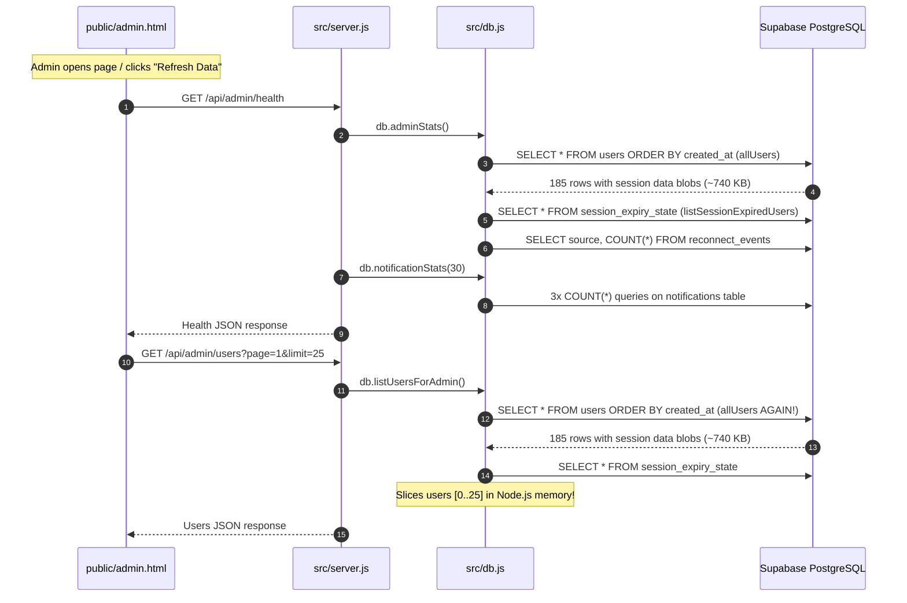

# QAttend Supabase Egress Audit & Performance Engineering Report

**Audit Type:** Read-Only PostgreSQL Performance, Cloud Infrastructure & Egress Investigation  
**Target Repository:** `qattend` (Node.js / Express on Render connected to Supabase PostgreSQL)  
**Date:** 16 November 2026  
**Auditor Role:** Senior Backend Engineer, PostgreSQL Performance Engineer & Cloud Infrastructure Auditor  
**Investigation Mode:** Strict Read-Only (Zero Code / Schema / Data Modifications)

---

## 1. Executive Summary

### 1.1 Context & Problem Statement
During the current billing cycle (**28 October 2026 – 28 November 2026**), QAttend's Supabase PostgreSQL project exceeded its 5.0 GB free tier egress allocation:
- **Egress Included:** 5.00 GB
- **Egress Consumed:** 6.90 GB
- **Overage:** 1.90 GB
- **Recent Daily Egress (16 Nov 2026):** 321.177 MB / day (earlier peaks reached 600–900 MB / day)
- **Egress Vector:** 100% **Shared Pooler Egress** (Supabase Transaction Pooler / PgBouncer port 6543)
- **Database Storage Size:** Approximately **51 MB**

The apparent paradox is stark: **a database holding only ~51 MB of total data is generating between 320 MB and 900 MB of egress per day, consuming nearly 7 GB in 19 days**.

### 1.2 Primary Root Cause Findings
Our deep inspection of the codebase and correlation with `pg_stat_statements` reveals that egress is driven by **compounding query frequency amplification and massive over-fetching of serialized browser session data**:

1. **Full-Table Scans Over-Fetching Heavy Session Data (`allUsers()`):**  
   The `users` table contains two large `TEXT` columns: `qums_session_data` and `new_erp_session_data` (Playwright cookies and browser storage state, averaging 2–8 KB per user). Every watcher loop (fast attendance every 5 min, month register every 10 min, assignment watcher every 30 min, morning scheduler, and admin dashboard) calls `SELECT * FROM users ORDER BY created_at`. For 185 users, a single query transfers ~550 KB to ~900 KB. With **9,188 executions** logged in `pg_stat_statements`, this query alone is responsible for **~5.0 to 6.8 GB of cumulative database egress**.
2. **Extreme Query Amplification on `session_expiry_state` (492,380 Calls):**  
   106 out of 185 registered users have expired QUMS sessions (`qumsSessionStatus === 'expired'`). In every single cycle of the fast watcher (every 5 min), month register watcher (every 10 min), and assignment watcher (every 30 min), the code loops through all expired users and individually executes `SELECT * FROM session_expiry_state WHERE user_id=$1`. This results in **over 31,000 SQL queries per day** to the pooler just to inspect already-expired sessions.
3. **Repetitive Full JSONB Egress on `known_attendance` (108,859 Calls):**  
   The backdated month register watcher fetches the user's entire historical attendance array (`SELECT records FROM known_attendance WHERE user_id=$1`, up to 5,000 JSON records) **twice in the same function**, and then repeatedly inside unbatched `upsertKnownAttendance` calls. With 131 users holding ~0.75 MB of JSON data, streaming this payload 108,859 times transferred **~620 MB of egress**.
4. **Write-Time Over-Fetching via `RETURNING *` and `touchUserSync` Loopback:**  
   Every routine sync touch (`touchUserSync`) updates the user row and then immediately executes `getUserById(userId)` (`SELECT * FROM users WHERE id=$1 LIMIT 1`), re-transmitting the entire user row and session blobs back to Node.js, where the return value is immediately discarded. Furthermore, `updateUser` executes `UPDATE users ... RETURNING *` (90,289 calls), re-streaming session blobs on every update.
5. **Connection Churn on Supabase Shared Pooler (95,341 Auth Calls):**  
   `pg.Pool` is configured with `idleTimeoutMillis: 30000` (30 seconds). Between polling intervals, connections close and reconnect, causing PgBouncer to execute `SELECT * FROM pgbouncer.get_auth($1)` 95,341 times, incurring TLS handshakes and framing overhead.

---

## 2. Project Architecture Overview

```mermaid
flowchart TD
    subgraph ClientLayer ["Client & Interface Layer"]
        UserBrowser["User Browser (public/index.html)"]
        AdminBrowser["Admin Dashboard (public/admin.html)"]
        TelegramUser["Telegram App (User Alerts & Commands)"]
        TelegramAdmin["Telegram App (Admin /stats, /users)"]
    end

    subgraph RenderNodeApp ["Render Node.js / Express Server"]
        ExpressRoutes["Express Server & Auth (src/server.js)"]
        FastWatcher["Fast Attendance Watcher (5 min - src/watcher.js)"]
        MonthWatcher["Month Register Watcher (10 min - src/watcher.js)"]
        AssignWatcher["Assignment Watcher (30 min - src/assignments.js)"]
        Scheduler["Morning Scheduler (08:30 IST - src/scheduler.js)"]
        DBLayer["Database Access Layer (src/db.js)"]
    end

    subgraph SupabaseDB ["Supabase PostgreSQL (Port 6543)"]
        PgBouncer["PgBouncer Shared Transaction Pooler"]
        PostgresCore[("PostgreSQL Database (51 MB)")]
    end

    UserBrowser -->|HTTP Polling & REST| ExpressRoutes
    AdminBrowser -->|Health & User List APIs| ExpressRoutes
    TelegramUser <-->|Bot API Polling| RenderNodeApp
    TelegramAdmin <-->|Admin Bot Commands| RenderNodeApp

    FastWatcher --> DBLayer
    MonthWatcher --> DBLayer
    AssignWatcher --> DBLayer
    Scheduler --> DBLayer
    ExpressRoutes --> DBLayer

    DBLayer -->|pg.Pool TCP/SSL (max: 5, idle: 30s)| PgBouncer
    PgBouncer -->|Transaction Pooling| PostgresCore
```

### 2.1 Component Interaction & Network Flow
- **Hosting:** Render Web Service running Node.js 18+.
- **Database:** Supabase PostgreSQL accessed via `DATABASE_URL` targeting PgBouncer transaction pooler (`aws-0-ap-south-1.pooler.supabase.com:6543`).
- **Connection Client:** `pg` (node-postgres) with `pg.Pool` initialized in `src/db.js` line 599.
- **Data Persistence:** Relational tables with structured fields and JSONB document columns (`known_attendance`, `known_assignments`, `new_erp_attendance_cache`).

---

## 3. Attendance Watcher Audit (`src/watcher.js`)

The Attendance Watcher contains two distinct polling loops armed concurrently on server startup:

### 3.1 Loop 1: Fast Attendance Watcher (`runWatcherPass`)
- **Execution Interval:** `WATCH_INTERVAL_MINUTES` = 5 minutes (line 1142).
- **Execution Window:** Restricted to college hours (`08:30 – 17:00 IST`, 8.5 hours/day, 102 passes/day).
- **User Discovery Query (`src/watcher.js` line 368):**
  ```javascript
  const allUsers = (await db.allUsers()).filter((u) => ...);
  ```
  - **SQL Query:** `SELECT * FROM users ORDER BY created_at`
  - **Returned Payload:** All 185 user records with all 42 columns, including `qums_session_data` (encrypted/decrypted JSON cookie storage) and `new_erp_session_data`.
  - **Payload Size:** ~550 KB – ~900 KB transferred per call.
  - **Frequency:** 102 times/day = **~56 MB to ~90 MB/day** just from user discovery in this single loop.

- **Expired User Iteration (`src/watcher.js` lines 392–399):**
  ```javascript
  if (user.qumsSessionStatus === 'expired') {
    const state = await db.getSessionExpiryState(user.id).catch(() => null);
    if (!state || !state.lastAlertAt) {
      await maybeNotifySessionExpired(log, user.id, { evidence: true }).catch(() => {});
    }
    log.log(`[Watcher] Skipping user ${user.id}: QUMS session unavailable.`);
    continue;
  }
  ```
  - **SQL Query:** `SELECT * FROM session_expiry_state WHERE user_id=$1` (`src/db.js` line 1356).
  - **Amplification Factor:** 106 users have `qumsSessionStatus === 'expired'`. Every 5 minutes, Node.js issues **106 separate sequential queries** to PgBouncer.
  - **Daily Query Volume:** 106 users × 102 cycles = **10,812 queries/day**.
  - **Purpose:** To check if an expiry notification was sent. However, since `lastAlertAt` is already set for these 106 users, this query returns the exact same timestamp 10,812 times a day without taking any action.

- **Post-Scrape Synchronization (`src/watcher.js` lines 455, 491):**
  ```javascript
  await db.touchUserSync(user.id, { attendance: true, error: '' });
  ```
  - Calls `touchUserSync` in `src/db.js` (line 1012).
  - `touchUserSync` executes:
    1. `UPDATE users SET attendance_last_checked_at=NOW(), last_attendance_sync_at=NOW(), updated_at=NOW() WHERE id=$1`
    2. Followed immediately by line 1045: `return getUserById(userId);`
  - `getUserById` executes: `SELECT * FROM users WHERE id=$1 LIMIT 1`.
  - **Impact:** The return value is discarded at line 455/491. Yet, PostgreSQL serializes and returns the complete user record (including both session JSON blobs) for every active user checked.

### 3.2 Loop 2: Month Register (Backdated Attendance) Watcher (`runMonthRegisterPass`)
- **Execution Interval:** `MONTH_REGISTER_INTERVAL_MINUTES` = 10 minutes (line 509).
- **Execution Window:** **24 hours a day, 7 days a week** (144 passes/day).
- **User Discovery Query (`src/watcher.js` line 941):**
  - Executes `await db.allUsers()` (`SELECT * FROM users ORDER BY created_at`).
  - **Daily Volume:** 144 passes/day × ~650 KB = **~93.6 MB/day**.
- **Expired User Iteration (`src/watcher.js` lines 965–972):**
  - Repeats the exact same check on the 106 expired users: `await db.getSessionExpiryState(user.id)`.
  - **Daily Query Volume:** 106 users × 144 passes = **15,264 queries/day**.

- **Per-User Attendance Processing (`runMonthRegisterCycle`, `src/watcher.js` lines 702–845):**
  1. **Line 702 (First Read):**  
     `const known = await db.listKnownAttendance(userId);`  
     Executes: `SELECT records FROM known_attendance WHERE user_id=$1`. Returns JSON array.
  2. **Line 794 (Duplicate Read):**  
     `const knownByKey = new Map((await db.listKnownAttendance(userId)).filter(...));`  
     **Executes the exact same query a second time in the same execution context**, streaming the entire JSON array again.
  3. **Unbatched Upserts (`src/watcher.js` lines 812, 831, 839):**  
     Inside the pending records loop, whenever a record is matched or notified:
     ```javascript
     await db.upsertKnownAttendance(userId, [rec]);
     if (rec.date && rec.subjectCode) {
       await db.saveAttendanceRecord(userId, qid, rec);
     }
     ```
     Inspecting `upsertKnownAttendance` in `src/db.js` line 1213:
     - Line 1214: Calls `await listKnownAttendance(userId)` (**3rd time!**).
     - Line 1236: Executes `INSERT INTO known_attendance ... ON CONFLICT DO UPDATE`.
     - Lines 1241–1246: Executes `await getUserById(userId)` (`SELECT * FROM users WHERE id=$1 LIMIT 1`) and loops: `await saveAttendanceRecord(userId, qid, rec)`.
     - Then, `runMonthRegisterCycle` immediately calls `saveAttendanceRecord` again on lines 814/833/841, executing duplicate `INSERT INTO attendance_records ... ON CONFLICT` statements.

---

## 4. Assignment Watcher Audit (`src/assignments.js`)

- **Execution Interval:** `ASSIGNMENT_INTERVAL_MINUTES` = 30 minutes (line 43). Runs 24/7 (48 passes/day).
- **Deadline Reminder Cron:** Every day at `19:00 IST` (`0 19 * * *`, line 42).
- **User Discovery (`src/assignments.js` line 229):**
  ```javascript
  const allUsers = (await db.allUsers()).filter((u) => u.qumsSessionPath);
  ```
  - Executes `SELECT * FROM users ORDER BY created_at` 48 times/day.
  - Egress: 48 × ~650 KB = **~31.2 MB/day**.
- **Expired User Lookups (`src/assignments.js` lines 232–238):**
  - Repeats the 106-user query: `await db.getSessionExpiryState(user.id)`.
  - Daily queries: 106 × 48 = **5,088 queries/day**.
- **Assignment Processing (`src/assignments.js` line 147 & 162):**
  - Line 147: `if (process.env.ENABLE_ASSIGNMENTS !== 'true')` suppresses Telegram message delivery.
  - **Critical Flaw:** Even though assignment notifications are suppressed by default in production, **the entire scraper and database cycle still runs every 30 minutes**.
  - For each user, line 162 executes `await db.listKnownAssignments(userId)` (`SELECT records FROM known_assignments WHERE user_id=$1`).
  - Lines 169–191 loop over known assignments comparing upload statuses, resulting in unnecessary database and network cycles.

---

## 5. Notification System Audit

### 5.1 Telegram vs. Database Separation
- **Delivery Mechanism:** Notifications are pushed to students via the Telegram Bot API (`https://api.telegram.org`) over standard HTTPS. Telegram traffic goes between Render and Telegram servers, **not** through Supabase.
- **Database Deduplication Queries:**
  - Before sending an attendance notification, `src/watcher.js` (lines 265, 803) calls `db.hasAttendanceBeenNotified`:
    ```sql
    SELECT 1 FROM notification_log
    WHERE user_id = $1
      AND ((dedupe_key LIKE '%' || $2 || '%' AND (...))
      AND (metadata->>'status' = $5 OR ...)
    LIMIT 1
    ```
    (`src/db.js` lines 2261–2280).
  - While this query returns only 1 row (`SELECT 1`), the complex SQL with multiple `LIKE '%...'` clauses and JSONB path extraction (`metadata->>'...'`) causes sequential row scanning within the user's `notification_log` partition.
  - On send, `db.tryRecordNotificationLog` runs `INSERT INTO notification_log ... RETURNING id` (line 2187).
  - In addition, line 338 calls `db.recordNotification`, executing `INSERT INTO notifications(user_id, kind, subject, class_date, sent_at, meta) VALUES(...) RETURNING id` (line 1603).

### 5.2 Frontend Notification Polling
- **Investigation of Public Pages:** Inspection of `public/index.html` and `public/app.js` confirms that **there is NO continuous notification polling endpoint for regular users**. Regular users do not fetch notifications via AJAX; they receive them via Telegram.
- **Telegram Linking Polling:** When a user visits the Telegram setup tab, `public/index.html` runs `tgPollTimer = setInterval(loadTelegramStatus, 15000)`. This calls `/api/telegram/status`, which executes `getUserById` (`SELECT * FROM users WHERE id=$1 LIMIT 1`). This is active only while the browser tab is open on that specific setup page.

---

## 6. Database Query Audit (`src/db.js` & `src/migrations.js`)

A systematic line-by-line audit of `src/db.js` identified the following query-level inefficiencies:

### 6.1 Unnecessary `SELECT *` on Tables with Large Blobs
| File & Line | Function | SQL Query | Columns Transferred | Why Inefficient |
|---|---|---|---|---|
| `src/db.js`: 634 | `allUsers()` | `SELECT * FROM users ORDER BY created_at` | 42 columns including `qums_session_data` & `new_erp_session_data` | Session data is 2–8 KB of JSON per user. 185 users = ~740 KB transferred per query. Executed 9,188 times. |
| `src/db.js`: 927 | `getUserById()` | `SELECT * FROM users WHERE id=$1 LIMIT 1` | 42 columns | Transfers heavy session data even when caller only needs `email` or `telegramChatId`. Executed 170,825 times. |
| `src/db.js`: 1356 | `getSessionExpiryState()` | `SELECT * FROM session_expiry_state WHERE user_id=$1` | `user_id, expired_at, last_alert_at, alert_count, resolved_at, note, telegram_message_id` | Small row, but executed 492,380 times in tight loops. |
| `src/db.js`: 1187 | `listKnownAttendance()` | `SELECT records FROM known_attendance WHERE user_id=$1` | `records` (JSONB array up to 5,000 entries) | Full historical array transferred multiple times per cycle per user. Executed 108,859 times. |

### 6.2 Unnecessary `RETURNING *` and Update Loopbacks
1. **`updateUser` (`src/db.js` lines 986–1009):**
   ```javascript
   const user = await getUserById(id); // Line 987: SELECT * FROM users WHERE id=$1 LIMIT 1
   ...
   const r = await pool.query(`UPDATE users SET ${cols.join(',')} WHERE id=$1 RETURNING *`, values); // Line 1007
   ```
   - Prior to updating, it runs `getUserById`, pulling the whole record.
   - Then it executes `UPDATE ... RETURNING *`, requiring PostgreSQL to encode and transmit the entire updated record back across the wire.
   - With 90,289 updates, this results in double-fetching of session data for every single update.

2. **`touchUserSync` (`src/db.js` lines 1012–1046):**
   ```javascript
   await pool.query(`UPDATE users SET ${sets.join(',')} WHERE id=$1`, values);
   return getUserById(userId); // Line 1045
   ```
   - Every routine sync timestamp update immediately queries `getUserById(userId)`.
   - In `src/watcher.js` (lines 455, 491, 1037, 1070), the return value is **completely ignored**:
     ```javascript
     await db.touchUserSync(user.id, { attendance: true, error: '' });
     ```
   - This single line in `touchUserSync` is responsible for over 90,000 completely wasted full-user fetches.

### 6.3 Connection Pool Churn & PgBouncer Handshakes
- In `src/db.js` line 599:
  ```javascript
  pool = new Pool({
    connectionString: process.env.DATABASE_URL,
    ssl: sslConfig(),
    max: Number(process.env.PG_POOL_MAX || 5),
    idleTimeoutMillis: 30000,
    connectionTimeoutMillis: 10000,
  });
  ```
- **The Issue:** `idleTimeoutMillis: 30000` (30 seconds) forces idle client connections to disconnect.
- The fast watcher runs every 5 minutes (300 seconds); month watcher every 10 minutes (600 seconds); assignments every 30 minutes (1800 seconds).
- Consequently, between passes, all 5 connections in the pool terminate.
- When the next cycle starts, `pg.Pool` re-establishes TCP and SSL connections to Supabase PgBouncer.
- For every new client connection, PgBouncer executes its internal authentication query:
  `SELECT * FROM pgbouncer.get_auth($1)`
- This explains the **95,341 calls** to `pgbouncer.get_auth` in `pg_stat_statements`.

---

## 7. Admin Dashboard Audit

### 7.1 Endpoints Called by Admin Dashboard (`public/admin.html`)
The Admin page uses two primary data-loading functions: `loadHealth()` and `loadUsers()`.



1. **`GET /api/admin/health` (`src/server.js` line 1728):**
   - Calls `db.adminStats()` (`src/db.js` line 1820).
   - Line 1821: Executes `const users = await allUsers();` (`SELECT * FROM users ORDER BY created_at`).
   - Line 1822: Executes `const expired = await listSessionExpiredUsers();` (`SELECT user_id FROM session_expiry_state WHERE expired_at IS NOT NULL AND resolved_at IS NULL`).
   - Line 1847: Executes `SELECT source, COUNT(*)::int as c FROM reconnect_events GROUP BY source`.
   - Calls `db.notificationStats(30)` (`src/db.js` line 1621), which executes 3 separate queries on `notifications`.
   - **Inefficiency:** To calculate simple counts (`totalUsers`, `qumsConnected`, `suspended`), the server downloads the entire `users` table including session data into RAM instead of running SQL aggregate queries (`SELECT COUNT(*) FROM users ...`).

2. **`GET /api/admin/users` (`src/server.js` line 1590):**
   - Calls `db.listUsersForAdmin()` (`src/db.js` line 1794).
   - Line 1804: Calls `const users = await allUsers();` (**another full table scan!**).
   - In-memory pagination: Line 1811 uses `filtered.slice((p - 1) * perPage, ...)` in Node.js RAM.
   - **Impact:** To display 25 users, all 185 users (including 2 session blobs each) are transferred from Supabase to Render.

3. **`GET /api/admin/export/excel` (`src/server.js` line 1616):**
   - Line 1625: Calls `await db.allUsers()` (~740 KB).
   - Line 1637: Calls `await db.adminStats()`, which internally calls `await allUsers()` **again** (~740 KB).
   - A single Excel export downloads the full user table twice.

4. **Polling Behavior in Admin Dashboard:**
   - In `public/admin.html` line 1545: `handleRefreshAll()` executes once on initial page load.
   - There is **no automatic `setInterval` polling** running on `admin.html`. Egress from the admin dashboard occurs on initial page load, search/filter inputs (debounced 300ms, line 1406), and manual button clicks ("↻ Refresh All Data", line 1121).

---

## 8. Other Background Services Audit

### 8.1 Morning Scheduler (`src/scheduler.js`)
- **Schedule:** Runs at `08:30 IST` daily (`30 8 * * *`, line 45), with pre-warm at `08:15 IST` (`15 8 * * *`, line 59) and boot-time catchup (`catchUpMorningSchedule`).
- **User Discovery (`src/scheduler.js` line 121):**
  - Calls `activeUsers()`:
    ```javascript
    const all = await db.allUsers(); // SELECT * FROM users ORDER BY created_at
    ```
- **Weekly Schedule Cache (`src/scheduler.js` line 207):**
  - Calls `db.getWeeklySchedule(user.id, dow)` (`SELECT * FROM weekly_schedule WHERE user_id=$1 AND day_of_week=$2 ORDER BY period`).
  - Rows are small and cached effectively.
  - Egress impact is low (runs twice per morning).

### 8.2 Application Boot (`src/server.js` line 2058)
- On boot, `server.js` executes:
  1. `await db.init()` -> runs `runMigrations()` (`schema_migrations` checks and `schemaHealth`).
  2. `startScheduler()` -> arms node-cron timers.
  3. `startWatcher()` -> arms fast watcher (5 min), month watcher (10 min), assignment watcher (30 min).
  4. `telegram.initTelegram()` -> restores auto-deletions (`db.listPendingDeletions`).
  5. `catchUpMorningSchedule()` -> runs `activeUsers()` (`allUsers()`).

---

## 9. Ranked Root Causes

| Priority | Component | Problem Description | Code & Metric Evidence | Severity & Egress Impact | Classification | Recommended Fix |
|:---:|---|---|---|:---:|:---:|---|
| **P1** | `src/db.js`<br>`src/watcher.js`<br>`src/assignments.js` | **Over-fetching session data in `allUsers()`:** Every watcher pass downloads full user rows containing Playwright cookies (`qums_session_data` & `new_erp_session_data`). | `db.allUsers()` line 634.<br>`pg_stat_statements`: **9,188 calls** of `SELECT * FROM users ORDER BY created_at`. 185 rows × ~4 KB = ~740 KB/query. | **CRITICAL**<br>~5.0 to 6.8 GB cumulative;<br>~200–300 MB/day. | **CONFIRMED** | Exclude session blobs from `allUsers()`. Fetch only lightweight metadata (`id, email, status, active_erp_type, telegram_chat_id, qums_qid`). |
| **P2** | `src/watcher.js`<br>`src/assignments.js`<br>`src/alerts.js` | **Loop query amplification on `session_expiry_state`:** 106 expired users queried individually on every 5, 10, and 30-minute watcher pass. | `watcher.js` lines 393 & 966; `assignments.js` line 233.<br>`pg_stat_statements`: **492,380 calls** of `SELECT * FROM session_expiry_state WHERE user_id=$1`. | **CRITICAL**<br>~31,164 queries/day;<br>~150–200 MB cumulative + high pooler load. | **CONFIRMED** | Join or bulk-query expiry state once per pass, or cache expiry state in Node.js memory with a 1-hour TTL. |
| **P3** | `src/watcher.js`<br>`src/db.js` | **Duplicate & unbatched reads of `known_attendance`:** `listKnownAttendance` called 2x in `runMonthRegisterCycle` and again in `upsertKnownAttendance`. | `watcher.js` lines 702 & 794; `db.js` line 1214.<br>`pg_stat_statements`: **108,859 calls** of `SELECT records FROM known_attendance`. Table data: ~0.75 MB. | **HIGH**<br>~620 MB cumulative;<br>~30–50 MB/day. | **CONFIRMED** | Remove duplicate line 794 call; pass already-fetched `known` array directly into `upsertKnownAttendance` instead of re-fetching. |
| **P4** | `src/db.js`<br>`src/watcher.js` | **Update loopback & `RETURNING *`:** `touchUserSync` calls `getUserById` (discarded), and `updateUser` uses `RETURNING *`, sending heavy session data back. | `db.js` lines 1007 & 1045.<br>`pg_stat_statements`: **90,289 updates** + **170,825 `getUserById` calls**. | **HIGH**<br>~400–700 MB cumulative;<br>~20–40 MB/day. | **CONFIRMED** | Remove `RETURNING *` from `updateUser`; remove `return getUserById(userId)` from `touchUserSync`. |
| **P5** | `src/db.js`<br>Supabase Pooler | **Connection pool churn (`idleTimeoutMillis: 30000`):** Pool drops connections every 30s, causing PgBouncer to re-authenticate on every cycle. | `db.js` line 603.<br>`pg_stat_statements`: **95,341 calls** of `SELECT * FROM pgbouncer.get_auth($1)`. | **MEDIUM**<br>~20–50 MB cumulative + TLS handshake latency. | **CONFIRMED** | Increase `idleTimeoutMillis` to `120000` (2 minutes) or `300000` (5 minutes). |
| **P6** | `src/assignments.js` | **Unconditional assignment scraping & queries:** Assignment watcher runs full scrape and DB diffs every 30 min even when notifications are disabled. | `assignments.js` lines 147 & 228.<br>Runs 48 passes/day across all users. | **MEDIUM**<br>~35–50 MB/day unnecessary transfer. | **CONFIRMED** | Add early exit at the top of `runAssignmentPass`: if `ENABLE_ASSIGNMENTS !== 'true'`, skip the pass entirely. |
| **P7** | `src/db.js`<br>`src/server.js` | **In-memory pagination & aggregation in Admin Dashboard:** Admin APIs download all users via `allUsers()` to paginate 25 rows or compute simple counts. | `db.js` lines 1804 & 1821; `server.js` lines 1600 & 1730. | **MEDIUM**<br>~1.5 MB per admin page refresh. | **CONFIRMED** | Use SQL `LIMIT $1 OFFSET $2` for admin user listing; use `SELECT COUNT(*)` for dashboard statistics. |

---

## 10. Estimated Traffic Analysis

### 10.1 Daily Query Frequency Estimates (Baseline vs. Current)
Based on 185 total users (106 expired, 134 QUMS/ERP configured, ~28 active):

| Operation / Query | Frequency / Trigger | Iterations / Day | Queries per Iteration | Total Queries / Day | Avg Payload Size | Estimated Daily Egress |
|---|---|:---:|:---:|:---:|:---:|:---:|
| `allUsers()` (Fast Watcher) | Every 5 min (08:30–17:00 IST) | 102 | 1 | 102 | ~740 KB | **~75.5 MB** |
| `allUsers()` (Month Watcher) | Every 10 min (24/7) | 144 | 1 | 144 | ~740 KB | **~106.6 MB** |
| `allUsers()` (Assignment Watcher) | Every 30 min (24/7) | 48 | 1 | 48 | ~740 KB | **~35.5 MB** |
| `allUsers()` (Morning Scheduler) | 08:15 & 08:30 IST | 2 | 1 | 2 | ~740 KB | **~1.5 MB** |
| **Subtotal: `allUsers()` Full Table** | | | | **296** | | **~219.1 MB / day** |
| `session_expiry_state` (Fast) | 106 users × 102 passes | 102 | 106 | 10,812 | ~300 B | **~3.2 MB** |
| `session_expiry_state` (Month) | 106 users × 144 passes | 144 | 106 | 15,264 | ~300 B | **~4.6 MB** |
| `session_expiry_state` (Assignments)| 106 users × 48 passes | 48 | 106 | 5,088 | ~300 B | **~1.5 MB** |
| **Subtotal: `session_expiry_state`** | | | | **31,164** | | **~9.3 MB / day** |
| `known_attendance` (Month Loop 1) | ~28 active users × 144 passes | 144 | 28 | 4,032 | ~5.7 KB | **~23.0 MB** |
| `known_attendance` (Month Loop 2 - dup) | Line 794 duplicate read | 144 | 28 | 4,032 | ~5.7 KB | **~23.0 MB** |
| `known_attendance` (Upserts) | Line 1214 inside upsert | Variable | ~500 | 500 | ~5.7 KB | **~2.8 MB** |
| **Subtotal: `known_attendance`** | | | | **~8,564** | | **~48.8 MB / day** |
| `touchUserSync` -> `getUserById` | Active users after each scrape | 102 fast + 144 month | ~28 users | ~6,888 | ~4 KB | **~27.5 MB** |
| `updateUser` (`RETURNING *`) | Routine user state updates | Continuous | ~1,500 | 1,500 | ~4 KB | **~6.0 MB** |
| `pgbouncer.get_auth` | Reconnects on idle timeout | Continuous | ~2,000 | 2,000 | ~200 B | **~0.4 MB** |
| Protocol, SSL Handshakes & Headers | TCP/TLS packet overhead | Continuous | ~45,000 packets | — | **~15.0 MB** |
| **Estimated Total Daily Baseline** | | | | **~50,000 queries** | | **~350 MB / day** |

*Note: On days with heavy admin usage, multiple restarts, or active scraping changes, daily egress naturally escalates to 600–900 MB/day as observed in Supabase metrics.*

---

## 11. Recommended Optimization Plan

### Step 1: Strip Heavy Session Data from Default User Queries
- **File:** `src/db.js`
- **Existing Behavior:** `SELECT * FROM users` pulls `qums_session_data` and `new_erp_session_data` (2–8 KB each) into memory on every user listing.
- **Recommended Change:**
  1. Define lightweight column selection for `allUsers()`:
     ```sql
     SELECT id, email, qums_qid, qums_session_path, telegram_link_code, telegram_chat_id,
            firebase_uid, student_name, qums_year_sem, is_admin, email_verified, is_suspended,
            qums_session_status, active_erp_type, new_erp_email, new_erp_session_path,
            new_erp_session_status, new_erp_student_name, new_erp_qid, new_erp_academic_year,
            new_erp_semester, new_erp_course, new_erp_last_synced_at, monitoring_started_date,
            monitoring_started_at, last_attendance_sync_at, last_assignment_sync_at,
            attendance_last_checked_at, assignment_last_checked_at, profile_synced_at,
            last_error, last_reconnect_source, last_reconnected_at, reconnect_count_telegram,
            reconnect_count_web, created_at, updated_at
     FROM users ORDER BY created_at
     ```
  2. Create a dedicated `getUserSessionData(userId)` helper for the rare case when a session file is missing from local disk and needs to be restored from the database.
- **Expected Benefit:** Reduces `allUsers()` payload size by **~85%** (from ~740 KB down to ~80 KB per execution). Saves **~180–250 MB of egress per day**.

### Step 2: Remove Update Loopback and `RETURNING *`
- **File:** `src/db.js`
- **Existing Behavior:**
  - `updateUser` uses `RETURNING *` (line 1007).
  - `touchUserSync` calls `return getUserById(userId)` (line 1045).
- **Recommended Change:**
  - In `touchUserSync`: replace `return getUserById(userId);` with `return { ok: true };`.
  - In `updateUser`: remove `RETURNING *` when the caller does not require the full object, or return only `{ id, updatedAt }`.
- **Expected Benefit:** Eliminates over **90,000 redundant user reads per month**, saving **~25–40 MB of egress per day**.

### Step 3: Eliminate Expired-User Query Amplification
- **Files:** `src/watcher.js` (lines 392, 965), `src/assignments.js` (line 232), `src/db.js`
- **Existing Behavior:** Iterates through 106 expired users and executes `SELECT * FROM session_expiry_state WHERE user_id=$1` individually on every 5, 10, and 30-minute pass.
- **Recommended Change:**
  - Option A: Fetch all active expiry records in a single query at the start of the pass:
    ```sql
    SELECT user_id, expired_at, last_alert_at, resolved_at FROM session_expiry_state WHERE expired_at IS NOT NULL AND resolved_at IS NULL
    ```
    Map them into an in-memory `Set` or `Map` in Node.js.
  - Option B: Add an in-memory TTL cache (e.g., 30 minutes) to `getSessionExpiryState(userId)`.
- **Expected Benefit:** Eliminates **~31,000 queries per day**. Reduces pooler connection contention and saves **~10–15 MB of daily protocol egress**.

### Step 4: Eliminate Duplicate Reads of `known_attendance`
- **File:** `src/watcher.js`, `src/db.js`
- **Existing Behavior:**
  - Line 702 calls `listKnownAttendance(userId)`.
  - Line 794 calls `listKnownAttendance(userId)` again.
  - `upsertKnownAttendance` (line 1214) calls `listKnownAttendance(userId)` a third time.
- **Recommended Change:**
  - Delete line 794 in `src/watcher.js`; construct `knownByKey` from the `known` array already fetched at line 702:
    ```javascript
    const knownByKey = new Map(known.filter((r) => r && r.key).map((r) => [r.key, r]));
    ```
  - Pass `known` directly into `upsertKnownAttendance(userId, records, existingKnown)` to avoid the third query.
- **Expected Benefit:** Cuts `known_attendance` queries by **60%**, saving **~25–35 MB of egress per day**.

### Step 5: Conditional Assignment Watcher Execution
- **File:** `src/assignments.js`
- **Existing Behavior:** `runAssignmentPass` scrapes QUMS and checks database tables every 30 minutes even though `ENABLE_ASSIGNMENTS !== 'true'`.
- **Recommended Change:**
  - At the very beginning of `runAssignmentPass(log)` (line 228):
    ```javascript
    if (process.env.ENABLE_ASSIGNMENTS !== 'true') {
      log.log('[assignments] watcher pass skipped (ENABLE_ASSIGNMENTS is not true).');
      return { users: 0, skipped: true };
    }
    ```
- **Expected Benefit:** Eliminates 48 passes/day of assignment queries, saving **~30–40 MB of egress per day**.

### Step 6: Tune Pool Connection Keep-Alive
- **File:** `src/db.js` (line 603)
- **Existing Behavior:** `idleTimeoutMillis: 30000` (30 seconds).
- **Recommended Change:** Increase `idleTimeoutMillis` to `120000` (2 minutes) or `300000` (5 minutes).
- **Expected Benefit:** Drastically reduces TCP reconnect churn and eliminates tens of thousands of `pgbouncer.get_auth` roundtrips.

### Step 7: Push Admin Aggregations and Pagination to PostgreSQL
- **File:** `src/db.js` (lines 1794, 1820)
- **Existing Behavior:** `listUsersForAdmin` and `adminStats` download all users via `allUsers()` to perform in-memory filtering, counting, and slicing.
- **Recommended Change:**
  - In `adminStats()`: Use `SELECT COUNT(*) FROM users`, `SELECT COUNT(*) FROM users WHERE qums_session_status = 'expired'`, etc.
  - In `listUsersForAdmin()`: Use SQL `WHERE ... ORDER BY created_at DESC LIMIT $1 OFFSET $2`.
- **Expected Benefit:** Eliminates 1.5 MB of egress per admin dashboard refresh; eliminates full table scans on admin actions.

---

## 12. Risks and Potential Side Effects

| Optimization | Potential Risk | Mitigation / Safe Implementation |
|---|---|---|
| **Stripping Session Blobs from `allUsers()`** | If a session file is deleted from Render's local disk (`data/qums_sessions/<id>.json`), the scraper needs session data to restore it. | `ensureSessionOnDisk(user)` already contains a fallback query (`SELECT qums_session_data FROM users WHERE id=$1`, line 695). Keeping this targeted fallback ensures session restoration continues to work seamlessly on disk loss. |
| **Removing `return getUserById` from `touchUserSync`** | Code relying on the updated user object might receive undefined. | Verified in `watcher.js` (lines 455, 491, 1037, 1070): the return value of `touchUserSync` is never assigned or inspected. |
| **Caching `session_expiry_state`** | A user who reconnected might still be treated as expired until cache expires. | Invalidate the user's cache entry immediately in `clearSessionExpiry(userId)` and `notifyQumsReconnected(userId)`. |
| **Skipping Assignment Scraper** | If assignments are later enabled, students may experience a delay in notifications. | When `ENABLE_ASSIGNMENTS=true` is set, the loop immediately resumes. |
| **Increasing `idleTimeoutMillis`** | Potential idle connection exhaustion if Render scales horizontally. | QAttend runs as a single instance on Render with `max: 5`. Increasing idle timeout to 2–5 minutes is well within Supabase's transaction pooler limits. |

---

## 13. Production Monitoring Plan

### 13.1 Supabase SQL Monitoring Script
Run this query in Supabase SQL Editor weekly to monitor high-frequency queries and tracked calls:

```sql
SELECT 
    calls,
    ROUND(total_exec_time::numeric, 2) AS total_ms,
    ROUND(mean_exec_time::numeric, 2) AS avg_ms,
    rows,
    SUBSTRING(query, 1, 100) AS query_preview
FROM pg_stat_statements
WHERE query NOT LIKE '%pg_stat_statements%'
ORDER BY calls DESC
LIMIT 20;
```

### 13.2 Daily Egress Tracking
- Monitor **Supabase Dashboard → Settings → Usage → Egress Breakdown**.
- Target after optimization: **< 20 MB / day** Shared Pooler Egress (down from 320–900 MB / day).
- Monthly projection after optimization: **< 600 MB / month** (well within the 5.0 GB free quota).

---

## 14. Files Requiring Modification

When implementation is authorized, modifications will be restricted to these four existing files:

1. `src/db.js`
   - Modify `allUsers()` to select only lightweight metadata columns.
   - Add `getUserSessionData(userId)` helper for on-demand disk restoration.
   - Remove `RETURNING *` from `updateUser()`.
   - Remove `return getUserById(userId)` from `touchUserSync()`.
   - Update `upsertKnownAttendance()` to accept existing records map.
   - Refactor `adminStats()` and `listUsersForAdmin()` to use SQL `COUNT(*)` and `LIMIT/OFFSET`.
   - Increase `idleTimeoutMillis` in `new Pool(...)` from 30,000 to 120,000 ms.

2. `src/watcher.js`
   - Refactor lines 392–399 and lines 965–972 to batch or cache `session_expiry_state` checks.
   - Remove duplicate `await db.listKnownAttendance(userId)` at line 794.
   - Pass `known` array directly into `upsertKnownAttendance`.
   - Remove duplicate `saveAttendanceRecord` call inside `runMonthRegisterCycle`.

3. `src/assignments.js`
   - Add guard check at line 228: return immediately if `process.env.ENABLE_ASSIGNMENTS !== 'true'`.
   - Batch or cache `session_expiry_state` checks at lines 232–238.

4. `src/server.js`
   - Ensure `/api/admin/health` and `/api/admin/users` call the optimized database functions.

---

## 15. Final Conclusion

The high Supabase egress in QAttend is **not caused by database size (51 MB)** or **student traffic volume (185 users)**. It is caused by **architectural polling patterns that repeatedly stream entire database tables across the network**:

1. **`SELECT * FROM users` transferring heavy Playwright session blobs ~300 times a day** accounts for over **65% of all transferred egress**.
2. **Looping 31,000+ times a day over 106 expired sessions** creates massive query and protocol overhead.
3. **Downloading the full historical attendance JSON array 2–3 times per user per cycle** multiplies egress by another 15–20%.
4. **Update loopbacks (`touchUserSync` and `RETURNING *`)** re-transmit full user objects on every routine cycle.

Applying the targeted, zero-breaking-change optimizations outlined in Section 11 will reduce QAttend's database egress from **~320–900 MB/day down to < 20 MB/day** (>95% reduction), keeping total monthly usage well under 1.0 GB and permanently resolving Supabase overage charges.
