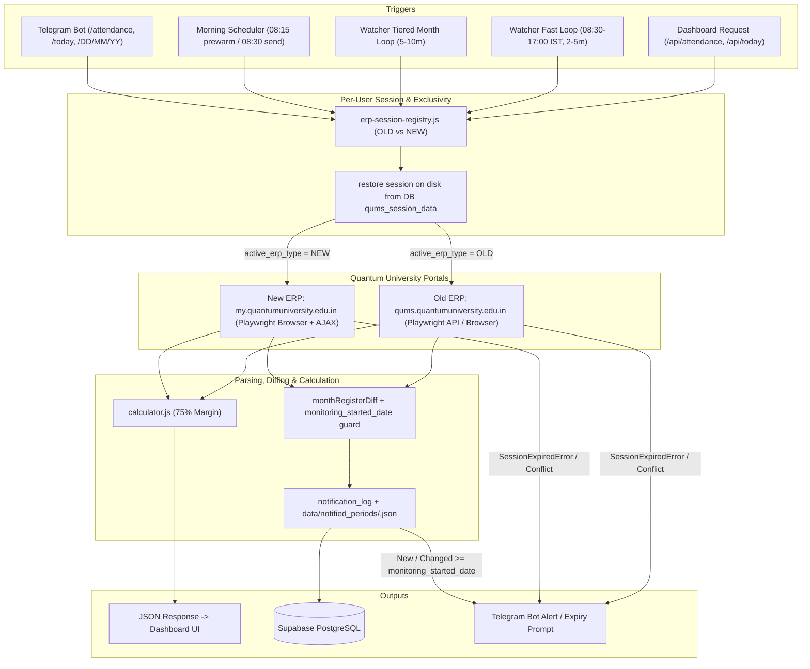

# QAttend — Quantum University ERP Integration & Data Fetching

QAttend supports **two separate Quantum University ERP portals** and enforces mutual exclusivity between them per university account (`src/erp-session-registry.js`).

---

## 1. Old ERP Integration (`qums.quantumuniversity.edu.in`)

### 1.1 Portal URLs & Discovered Endpoints (`src/scraper.js`, `src/qums-login-web.js`)

| Purpose | Method | Endpoint / URL | Payload / Parameters |
| :--- | :--- | :--- | :--- |
| **Login Page** | `GET` | `https://qums.quantumuniversity.edu.in/` (`QUMS_LOGIN_URL`) | Headless Chromium (`img#imgPhoto` CAPTCHA) |
| **Student Dashboard** | `GET` | `/Web_StudentAcademic/Cyborg_S_Dashboard` (`QUMS_DASHBOARD_URL`) | Extracts embedded `var RegID = '...'` |
| **Timetable Page** | `GET` | `/Web_StudentAcademic/Cyborg_StudentTimeTable?id=Time%20Table` (`QUMS_TIMETABLE_URL`) | Browser fallback jqGrid DOM scrape |
| **Timetable Data API** | `POST` | `/Web_StudentAcademic/FillStudentTimeTable` | Form `{ RegID }` -> `{ state: "<JSON rows>" }` |
| **Subject Attendance API** | `POST` | `/Web_StudentAcademic/GetYearSemWiseAttendance` | Form `{ RegID, YearSem: 1..8 }` -> `{ data, state }` |
| **Today's Attendance API** | `POST` | `/Web_StudentAcademic/GetTodayAttendance` | Form `{ RegID, date: 'DD/MM/YYYY' }` -> `{ state }` |
| **Month Register API** | `POST` | `/Web_StudentAcademic/GetMonthRegister` | Form `{ RegID, Month: 1..12 }` -> `{ state, data }` |
| **Student Profile API** | `POST` | `/Web_StudentAcademic/GetStudentDetailOnRegID` | JSON `{ RegID }` (form fallback) -> `{ state }` |
| **Profile Tile Fallback** | `POST` | `/Web_StudentAcademic/GetStudentTileData` | JSON `{ RegID }` |
| **Assignments Page** | `GET` | `/Web_StudentAcademic/Cyborg_StudentAssignment?id=Assignment` (`QUMS_ASSIGNMENT_URL`) | Reference URL |
| **Assignments Data API** | `POST` | `/Web_StudentAcademic/GetStudentAssignment` | Form `{ RegID }` -> `{ state, state2 }` |

### 1.2 Headless CAPTCHA Relay Login Flow (`src/login.js`, `src/qums-login-web.js`)
QAttend never uses an automated CAPTCHA solver or bypass; the student manually solves the CAPTCHA:
1. **`startQumsLogin(userId, { qid, password, confirmSwitch })`:**
   - Resolves `qid` and `password` (using `qumsPasswordEncrypted` from DB if omitted during reconnect).
   - Checks for identity change (`user.qumsQid !== qid`): throws `IdentityConflictError` (`409`) unless `confirmSwitch: true`.
   - Calls `checkSessionEligibility(qid, userId, 'OLD')`: blocks (`409`) if active in New ERP.
   - Enforces concurrency guards (`MAX_CONCURRENT_PENDING = 15`, `MAX_CONCURRENT_LAUNCHES = 6`, `PENDING_TTL_MS = 3 min`).
   - Launches headless Chromium (`openLoginFormPage`), aborts `font` and `media` requests, navigates with `waitUntil: 'commit'`, locates frame with text + password inputs (`findLoginForm`), fills QID (`input#UserName` or heuristic) and password (`input[type="password"]`).
   - Captures `img#imgPhoto` via `captureCaptchaImage()` and pads it onto a `2x` canvas with white margins (`padX = 65`, `padY = 28`) so mobile Telegram bubbles do not clip edge characters. Returns `{ ok: true, captchaImage }`.
2. **`submitQumsCaptcha(userId, rawCaptchaText)`:**
   - Trims and uppercases input (`6`-char QUMS CAPTCHA), fills `input#captcha`, clicks `button.btnSubmit`, and waits for the POST response.
   - Evaluates `isLoginLikeUrl(page.url())`:
     - If still on login page, reads `.validation-summary-errors, .field-validation-error` and classifies `INVALID_CAPTCHA`, `INVALID_CREDENTIALS`, `SESSION_EXPIRED`, or `PORTAL_TIMEOUT`. On non-timeout failure, captures the refreshed inline CAPTCHA image for retry.
   - On navigation success:
     - Exports Playwright `context.storageState()` to `data/qums-sessions/<userId>.json` (`0600` mode).
     - Calls `completeQumsSetup()`: saves `qumsQid`, `qumsSessionPath`, `qumsSessionStatus: 'active'`, AES-256-GCM encrypted `qumsSessionData`, AES-256-GCM encrypted `qumsPasswordEncrypted`, sets `monitoringStartedDate`/`monitoringStartedAt` if first time, and updates `qums_identities`. *(Audit Note: Although comments in `README.md` and `src/credentials.js` state QUMS passwords are not stored, `completeQumsSetup` in `src/qums-login-web.js` lines 542–548 explicitly encrypts and persists `qumsPasswordEncrypted` to enable Telegram `/reconnect` without re-typing the password.)*
     - Calls `acquireSession({ identity: qid, userId, targetErp: 'OLD' })`.
     - Records reconnect telemetry (`recordUserReconnect`).
     - Fetches profile (`fetchQumsProfile`) and runs either `initializeSilentBaseline` (first time) or `runReconnectCatchup` (reconnect).

### 1.3 Data Fetching & Parsing (`src/scraper.js`)
- **HTTP Transport:** Uses `playwrightRequest.newContext({ storageState, baseURL, extraHTTPHeaders: { 'X-Requested-With': 'XMLHttpRequest', Referer: DASHBOARD_URL } })` — fast and browser-free for most endpoints.
- **RegID Caching:** `regIdMemoryCache` caches `RegID` per `sessionPath` for 30 minutes.
- **Semester Auto-Detection (`getStudentContext`):** Tries `opts.yearSem` first; if missing or empty, probes `YearSem` `1..8` in parallel via `Promise.all`, picking the first semester returning valid subjects (fallback: `QUMS_CURRENT_YEARSEM`).
- **Response Parsing:**
  - `GetYearSemWiseAttendance`: Parses `payload.data` JSON string into `Subject`, `SubjectCode`, `Percentage`, `TotalLecture`, `TotalPresent`, `TotalAbsent`, `TotalLeave`, and `payload.state[0].TotalPercentage` (official overall %).
  - `GetTodayAttendance`: Maps `Period`, `Duration`, `subject`, `SubjectCode`, `Employeename`, `Attend` (`N.M.` -> `'unmarked'`, `P` -> `'present'`, `A` -> `'absent'`, else `'other'`). Key: `${period}-${subjectCode}`.
  - `GetMonthRegister`: `expandMonthRegisterRows()` iterates columns `1..31`, skipping `'N'`, splitting multi-lecture cells like `'P,P'` into `lectures[]`, keying each record as `${YYYY-MM-DD}-${subjectCode}`.
  - `FillStudentTimeTable` / `parseTimetableInPage`: Handles multi-subject cells (`splitTimetableEntries`), extracts `(CODE)` and `(ROOM)` groups + teacher after last comma, normalizes portal day typos via `DAY_ALIASES` (e.g., `"Thrusday"` -> `'thursday'`), and provides `QUMS_STANDARD_DURATIONS` fallback (`P1`–`P8`).
  - `GetStudentAssignment`: Merges `payload.state` (dated assignments) and `payload.state2` (study materials) via `normalizeAssignmentRow()`.
- **Error Classification:**
  - `SessionExpiredError`: Thrown ONLY on confirmed login HTML (`looksLikeLoginHtml`) or login URL redirect.
  - `QumsUnreachableError`: Thrown on socket/DNS/timeout/5xx/temporary HTML error pages — prevents false expiry notifications.

---

## 2. New ERP Integration (`my.quantumuniversity.edu.in`)

### 2.1 Portal Endpoints (`src/new-erp-client.js`)

| Purpose | Method | Endpoint / URL | Notes |
| :--- | :--- | :--- | :--- |
| **Login Page** | `GET/POST` | `https://my.quantumuniversity.edu.in/` (`NEW_ERP_BASE_URL`) | `#txtStuID`, `#password-field`, `button[type="submit"].login-btn`; no CAPTCHA |
| **Academic / Timetable Page** | `GET` | `/Student/Academic` | Intercepts `GetWeekCalendarStudentData` |
| **Week Calendar AJAX** | `POST` | `/Student/StudentAtt/GetWeekCalendarStudentData` | FormData: `SessionId`, `CoursesGuids`, `attendanceDate`, `attendanceEndDate` |
| **Attendance Page** | `GET` | `/Student/Academic/StudentAttendance` | Intercepts `GetStudentCourseWiseLectureInfo` |
| **Course Lectures AJAX** | `POST` | `/Student/StudentAtt/GetCourseWiseLectureListingOnStudPortalWeekView` | Form: `CourseGuid`, `PBSMRecordID`, `startOfMonth`, `endOfMonth` |
| **Assessments Page** | `GET` | `/Student/Student/Assessments` | Entry page for AJAX fetches |
| **Assessments JSON** | `GET` | `/Student/Student/GetMyAssessmentsData` | Returns formative/summative/quiz/viva JSON array |
| **Assignments JSON** | `GET` | `/Student/Student/GetMyAssignmentsData` | Returns assignments JSON array |

### 2.2 Login & Session Conflict Handling
- Uses headless Playwright Chromium with `ignoreHTTPSErrors: true` and a fixed desktop Windows `SHARED_USER_AGENT`.
- **Active Portal Session Conflict:** If the portal displays `"user session is already active"` / `"logout all session"` (in `#spanerrror`, `#otpErrorText`, `.swal2-title`, etc.):
  - If `logoutOtherSessions` is `false`, throws `NewErpSessionConflictError` (`409 PORTAL_ACTIVE_SESSION_CONFLICT`, `canLogoutAll: true`).
  - If `logoutOtherSessions` is `true` (user clicked **"Logout All Sessions & Reconnect"** or Telegram **"1-Click Reconnect"**), clicks the portal's `logoutSessions` element, waits for confirmation text, and retries login once.
- **Persistence:** Saves Playwright `storageState` to `data/new-erp-sessions/<userId>.json` + encrypted in `users.new_erp_session_data`, encrypts password in `users.new_erp_password_encrypted`, extracts profile via `parseNewErpProfile()` (name, QID, course, academic year, semester), and calls `acquireSession(..., 'NEW')`.
- **HTML Parsing (`src/new-erp-client.js`):**
  - `parseNewErpTimetable()`: Parses `<header class="bg-blue-800 ...">` + `<section class="w-100 bl-primary ...">` cards (with table and inline script JSON fallbacks).
  - `parseNewErpAttendance()`: Extracts `.lectNum` (conducted), `.TPNum` (attended), `.TANum` (absent), `data-progress` (overall %), `.course-section` cards (or table fallback), and `.lectDateCard` lecture logs (`Present`, `Absent`, `Not Marked` — never counting `Not Marked` as `Absent`).

---

## 3. Centralized Session Exclusivity (`src/erp-session-registry.js`)

- `checkSessionEligibility(identity, userId, targetErp)` checks both `users` status fields and `active_erp_sessions` table.
- If the identity has an active session in the **other** ERP (`OLD` vs `NEW`), login is blocked with HTTP `409 SESSION_CONFLICT` / `SESSION_EXCLUSIVITY_BLOCKED` until the user disconnects or uses `/api/erp/switch`.
- Expired sessions (`status = 'expired'`) do not block switching.

---

## 4. Data Classification: Live vs Stored vs Cached vs Calculated

| Data Category | Live ERP Data | Stored in Supabase (`users` / tables) | Cached (In-Memory / DB TTL) | Calculated by QAttend |
| :--- | :--- | :--- | :--- | :--- |
| **Student Name / QID / Sem / Course** | Fetched from `GetStudentDetailOnRegID` / `StudentProfileNew` | Cached in `users` & `qums_identities` (`6h` TTL `QUMS_PROFILE_TTL_MS`) | `regIdMemoryCache` (`30m` TTL) | — |
| **Subject Attendance & Overall %** | Old ERP `GetYearSemWiseAttendance`; New ERP `StudentAttendance` | New ERP cached in `new_erp_attendance_cache` | Server `attendanceCache` (`2m` TTL); Browser `localStorage` (`qattend_attendance_cache`) | `calculator.js`: `classesNeededToReach75`, `classesCanSkipAndStay75`, `overall` weighted fallback if `st.TotalPercentage` absent |
| **Today's Classes & Marks** | Old ERP `GetTodayAttendance`; New ERP `GetCourseWiseLectureListing...` | Fast dedupe state on disk `data/notified_periods/<id>.json` | Server `todayCache` (`2m` TTL) | `mergeScheduleWithRoom`, `combineTimetableWithLiveAttendance` |
| **Weekly Timetable** | Old ERP `FillStudentTimeTable`; New ERP `/Student/Academic` | `weekly_schedule` (`7d` TTL), `new_erp_timetable` | Server `timetableCache` (`10m` TTL), Watcher `timetableCache` (`60m` TTL) | Chronological sorting & period normalization |
| **Month Register / Historical Marks** | Old ERP `GetMonthRegister`; New ERP `GetCourseWiseLectureListing...` | `known_attendance` (JSONB) + `attendance_records` | Tier scan clock in `data/month_register_tier_state.json` | `monthRegisterDiff()` transitions (`N->P`, `P->A`, etc.) |
| **Assignments & Assessments** | Old ERP `GetStudentAssignment`; New ERP `GetMyAssignmentsData` / `GetMyAssessmentsData` | `known_assignments` (JSONB) + `assignments` | — | `assignmentFingerprint()`, `pendingNewAssignments()`, `pendingDeadlineReminders()` |

---

## 5. Attendance & ERP Data Flow Diagram

