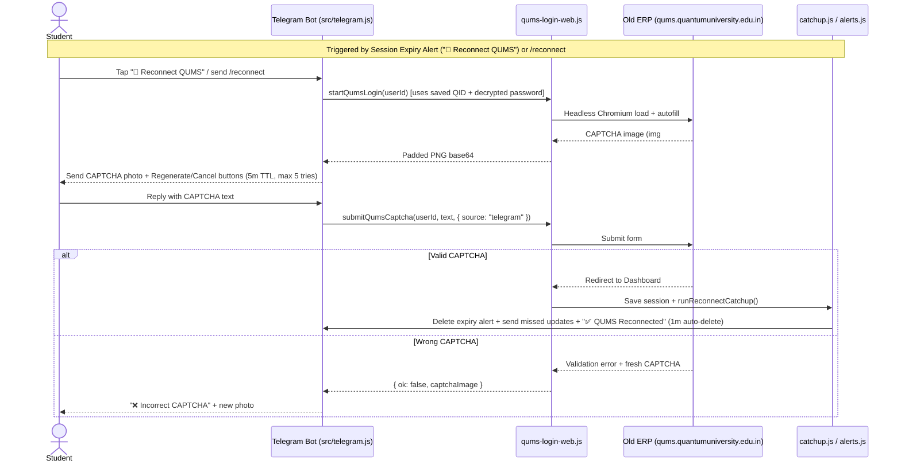

# QAttend — Telegram Bot Integration

The Telegram bot (`src/telegram.js`, `src/telegram-admin.js`, `src/alerts.js`, `src/messages.js`) is QAttend's primary notification and conversational interface.

---

## 1. Initialization, Polling & Singleton Guards (`src/telegram.js`)

- **Library:** `node-telegram-bot-api` (`^0.66.0`) in **long-polling mode** (no webhook route exists).
- **Process Singleton:** Uses `globalThis.__qumsTelegramState__` so repeated `require('./telegram')` calls never register duplicate listeners.
- **Machine-Level PID Lock (`acquirePollingLock`):**
  - Writes `{ pid, bot, startedAt }` to `data/telegram-polling.lock` (or `TELEGRAM_POLLING_LOCK`).
  - Checks `pidAlive(existing.pid)` via `process.kill(n, 0)`. If another live process holds the lock or if `TELEGRAM_POLLING=off|false|0|no|disable`, creates a **send-only** `TelegramBot` instance (`polling: false`) so `getUpdates` 409 conflicts and duplicate `/start` replies never occur.
  - Cleans up lock on `process.on('exit', releasePollingLock)`.
- **Update Deduplication (`isDuplicateUpdate`):** Tracks `${chatId}:${messageId}` in `state.seenMessages` (capped at 1,000 keys / 10-min window) to prevent duplicate execution when both `bot.onText` and `bot.on('message')` fire for the same message.
- **Formatting:** `toTelegramHtml()` escapes `<>&` and converts WhatsApp-style `*bold*` and `_italic_` into HTML `<b>` / `<i>` (`parse_mode: 'HTML'`), with plain-text and markup-stripped fallbacks on send failure.

---

## 2. User Account Linking (`handleDeepLink` / `handleLinkCommand`)

1. **Deep-Link Generation:** `GET /api/telegram/status` calls `db.telegramLinkCodeFor(userId)` (12-char random hex stored in `users.telegram_link_code`) and builds `https://t.me/<BOT_USERNAME>?start=<linkCode>`.
2. **User Flow:** Student clicks **"Connect Telegram"** on `/dashboard` or `/telegram-setup`, Telegram opens, and student taps **Start** (sending `/start <linkCode>`). Backup command: `/link <linkCode>`.
3. **Privacy Binding (`clearTelegramChatForChat`):**
   - One Telegram chat can belong to **only one** QAttend account at a time. Linking a chat automatically clears `telegram_chat_id` from any previous account bound to that `chatId`.
   - User emails are never sent to Telegram; greetings use `studentName` (fetched via `ensureStudentName` if missing).
4. **Unlinking:** `POST /api/telegram/unlink` clears `users.telegram_chat_id`.

---

## 3. Bot Commands & Message Routing (`handleUserMessage`)

| Command / Input | Handler | Behavior & Data Source | Auto-Delete Timing |
| :--- | :--- | :--- | :--- |
| `/start` | `handleStart` | If linked: command menu; if unlinked: welcome message | 1 min (`60,000 ms`) |
| `/start <code>`, `/link <code>` | `handleDeepLink` | Binds `telegramChatId` to user matching `telegram_link_code` | 1 min |
| `/help`, `hi`, `hello`, `hey`, `help` | `handleHelp` | Lists commands and automatic notification schedule | 1 min |
| `/status`, `status` | `handleStatus` | Shows Student Name, QID, Course/Sem, Monitoring & Session status. For expired New ERP, attaches `⚡ 1-Click Reconnect` button. | **2 min (`120,000 ms`)** |
| `/attendance`, `attendance` | `handleAttendance` | Old ERP: live `scrapeAttendance` + `analyzeAttendance`, offline fallback to `known_attendance`. New ERP: live `scrapeNewErpAttendance`, fallback to `new_erp_attendance_cache`. | 1 min |
| `/today`, `today`, `timetable`, `schedule`, `aaj ki class` | `handleToday` | Old ERP: `scrapeTodaysAttendance` + `scrapeTimetable` merge, fallback to `weekly_schedule`. New ERP: `new_erp_attendance_cache` for today or `new_erp_timetable`. | 1 min |
| `/DD/MM/YY`, `/DD-MM-YYYY`, `yesterday`, `kal` | `handleDateAttendance` | Validates calendar date & blocks future dates; Old ERP calls `scrapeMonthRegister` (+ `scrapeTodaysAttendance` if today + timetable enrichment, offline fallback `known_attendance`); New ERP filters `new_erp_attendance_cache.dailyRecords`. Splits long outputs into 4,000-char chunks. | 1 min |
| `/assignments`, `assignments` | `handleAssignments` | Old ERP: lists `db.listKnownAssignments(userId)`. New ERP: live `scrapeNewErpAssignments()`, filters `!isSubmitted`, fallback to `known_assignments`. | 1 min |
| `/reconnect`, `reconnect` | `handleReconnectCommand` | Old ERP: starts CAPTCHA reconnect (`startTelegramCaptchaReconnect`). New ERP: runs `executeNewErp1ClickReconnect`. | 1 min (user cmd) |
| `/admin`, `admin` | `telegram-admin.js` | Opens inline Admin Management Panel if `isChatAdmin(chatId)` | 1 min (user cmd) |

*Note: All incoming user command messages are also scheduled for auto-deletion (`60s`, or `120s` for `/status`).*

---

## 4. Message Classification & Persistent Auto-Deletion

`classifyMessage(opts, text)` assigns every outbound message a category (`MESSAGE_CATEGORIES`):

| Category | Examples | Retention Policy |
| :--- | :--- | :--- |
| `ATTENDANCE` | Fast-loop period marks, backdated updates, status changes | **Permanent** (never auto-deleted) |
| `ASSIGNMENT` | New assignment alerts, 7 PM deadline reminders | **Permanent** unless assignment is later detected as uploaded (`uploadFlag === 1`), in which case `assignments.js` deletes `rec.telegramMessageId` |
| `MORNING_SCHEDULE` | 8:30 AM IST daily class timetable | Auto-deleted **next day at 08:00:00 AM IST** (`calculateMorningTimetableDeleteAt`) |
| `ALERT` | Session Expired, Session Conflict | Retained until user reconnects (`deleteSessionExpiredAlert` deletes them on reconnect) |
| `TEMPORARY` | Command responses, CAPTCHA images, Reconnected confirmation | Auto-deleted after **1 minute** (`2 min` for `/status`) |

**Restart Persistence:** Every scheduled deletion is written to PostgreSQL `scheduled_message_deletions` (`db.addScheduledDeletion`). On bot startup, `restoreScheduledDeletions()` reloads pending rows, immediately deletes overdue messages, and re-arms `setTimeout` timers for future ones.

---

## 5. Automated Notifications & Scheduled Jobs

1. **Morning Timetable (`src/scheduler.js`):**
   - `08:15 AM IST` (`MORNING_PREWARM_CRON`): Pre-warms `weekly_schedule` cache without sending messages.
   - `08:30 AM IST` (`MORNING_CRON`, `recoverMissedExecutions: true`): Sends today's schedule (`formatMorningSchedule`) to all active non-suspended users. Guarded by `data/morning_schedule_state.json` AND `notification_log` (`morning_schedule:<userId>:<YYYY-MM-DD>`), with boot catch-up until `11:00 AM IST` (`MORNING_LATE_SKIP_HOUR`).
2. **Fast Attendance Watcher (`src/watcher.js`):**
   - Runs every `WATCH_INTERVAL_MINUTES` (default 5 min; `.env` sets 2 min) during `08:30–17:00 IST`.
   - Alerts on newly marked periods (`unmarked` → `present`/`absent`) or same-day status transitions (`present` ↔ `absent`). Deduplicated via `data/notified_periods/<userId>.json` + `notification_log` (`attendance_fast:...`).
3. **Backdated Month-Register Watcher (`src/watcher.js`):**
   - Runs every `MONTH_REGISTER_INTERVAL_MINUTES` (default 10 min; `.env` sets 5 min) 24/7.
   - Detects new backdated marks and status changes (`A -> P`, `P -> A`) across tiered months, strictly suppressing any `class_date < monitoring_started_date`. Deduplicated via `known_attendance` + `notification_log` (`attendance_month:...`).
4. **Assignment Alerts & Deadline Reminders (`src/assignments.js`):**
   - Polls every `ASSIGNMENT_INTERVAL_MINUTES` (30 min) for new assignments and fires at `19:00 IST` (`0 19 * * *`) on deadline day. **Currently suppressed unless `ENABLE_ASSIGNMENTS=true`.**
5. **Session Expiry & Conflict Alerts (`src/alerts.js`):**
   - Triggered ONLY on confirmed `SessionExpiredError` / `NewErpSessionExpiredError` / `NewErpSessionConflictError` (never on network timeouts).
   - Rate-limited by `SESSION_ALERT_COOLDOWN_MS` (default `12h`) in `session_expiry_state` + `alertInFlight` mutex.

---

## 6. Telegram Reconnect Flows

### 6.1 Old ERP CAPTCHA Reconnect State Machine
1. User taps `🔄 Reconnect QUMS` (`callback_data: 'qums_start_reconnect'`) or sends `/reconnect`.
2. `startTelegramCaptchaReconnect(userId)` verifies saved `qumsQid` + `qumsPasswordEncrypted`, calls `qumsLogin.startQumsLogin(userId)`, and sends the padded CAPTCHA PNG via `sendPhoto` with inline buttons `🔄 Regenerate CAPTCHA` (`qums_regen_captcha`) and `❌ Cancel Reconnect` (`qums_cancel_reconnect`).
3. Enters `reconnectStates` (`state: 'QUMS_RECONNECT_WAITING_CAPTCHA'`, TTL `5 min`, `MAX_CAPTCHA_ATTEMPTS = 5`). Mutex sets (`regeneratingChats`, `reconnectingChats`, `rState.submitting`) prevent duplicate browser launches.
4. User replies with CAPTCHA text → `handleUserMessage` calls `qumsLogin.submitQumsCaptcha(userId, text, log, { source: 'telegram' })`:
   - **Success:** Deletes CAPTCHA photo, user text messages, and old expiry alert; runs `runReconnectCatchup()` (sends missed attendance/assignment changes); sends `✅ QUMS Reconnected` (auto-deleted after 1 min).
   - **Wrong CAPTCHA:** Increments `attempts`, sends new CAPTCHA photo (up to 5 attempts).
   - **Invalid Credentials (`INVALID_CREDENTIALS`):** Clears state and sends link to `/qums-setup?reconnect=1`.

### 6.2 New ERP 1-Click Reconnect
- User taps `⚡ 1-Click Reconnect` (`callback_data: 'new_erp_1click_reconnect'`) or sends `/reconnect`.
- `executeNewErp1ClickReconnect()` decrypts `newErpPasswordEncrypted`, calls `newErpClient.loginNewErp({ email, password, logoutOtherSessions: true })`, saves new session, deletes expiry alert, and sends `✅ New ERP Reconnected` (auto-deleted after 1 min).

